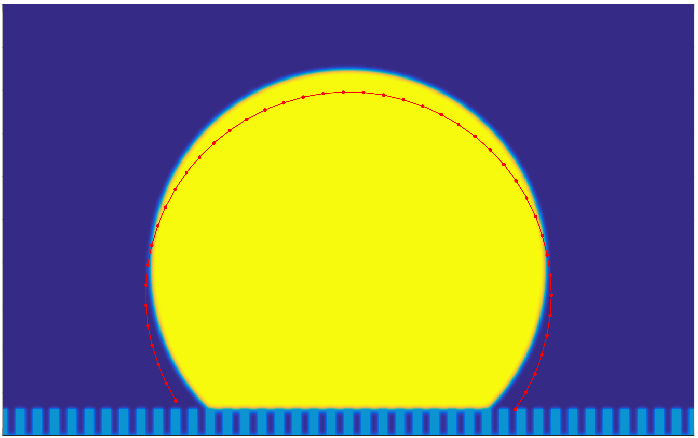
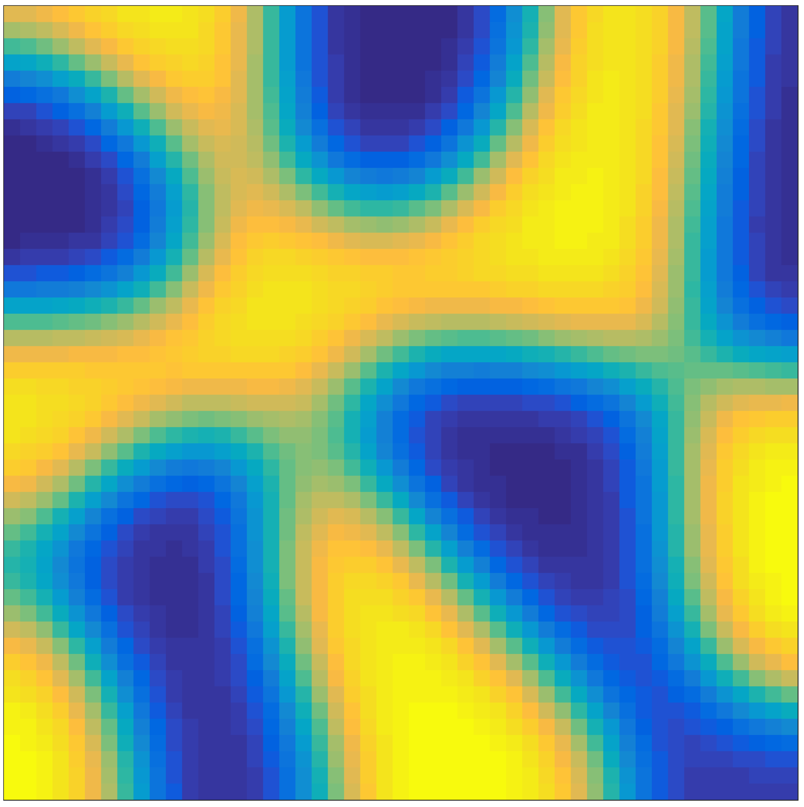
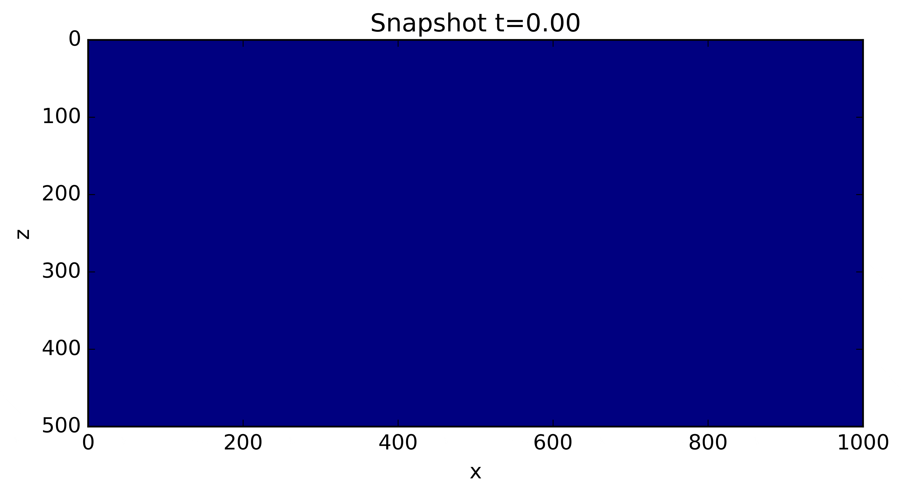
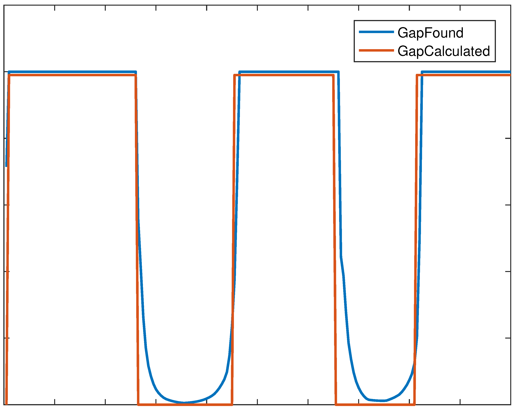

# Hello World
This GitHUB Page is built to present several projects that I worked / I'm working on.

# Projects

### Deep Reinforcement Learning in playing Atari games
> I'm currently studying on this topic with [Nikolaos Tziortziotis](http://www.lix.polytechnique.fr/Labo/Nikolaos.Tziortziotis/) and [Prof. Jesse Read](http://jmread.github.io/) in DaSciM Team under the supervision of [Prof. Michalis Vazirgiannis](http://www.lix.polytechnique.fr/~mvazirg/).
>
> Due to the lack of Nvidia GPU in my laptop, I use the Jetson-TX2 device for coding and testing.

-   [Installation of environments](page/Jetson-TX2)

### Hacking the Paris metro
> Project of course "INF442 : Treatment of Big Data" at École Polytechnique

The objective is to do big data analysis by using the real data from RATP.

[More details](https://github.com/mathpluscode/2A-INF442-Project#hacking-the-paris-metro)

### Lotus effect and spinodal decomposition phenomenon
> Project "MAP474C : Numerical Simulation of PDE" at École Polytechnique
>
> Under the supervision of Prof. [François Alouges](http://www.cmap.polytechnique.fr/~alouges/)

The objective is to use Finite Difference Method to study lotus effect and spinodal decomposition.

[More details](source/doc/MAP474C-AroundPhaseFieldModeling.pdf)

### Underground explosion

> Project of course "INF431 : Concurrency" at École Polytechnique

The objective is to simulate the propagation of the acoustic waves engendered by an explosion of a bomb which is equivalent to solve an acoustic wave equation.

We use the Finite Difference Method as scheme and JAVA Threads to do parallel computing.

[More details](page/2A-INF431-Project)

### Phenomenon of slow light and forbidden frequency

> Part of Scientific Collective Project of the second year at École Polytechnique
>
> Under the supervision of Prof. [ALLAIRE Grégoire](http://www.cmapx.polytechnique.fr/~allaire/GAUS.html)

The objective is to simulate the phenomenon of slow light and forbidden frequency by solving Bloch spectral cell equations and wave equations.

We use the Finite Element Method as scheme with the help of Gauss-Legendre quadrature.

# Notes
> Notes of several MOOCs about AI, DL, NLP, etc.

[Note List](page/notebook)