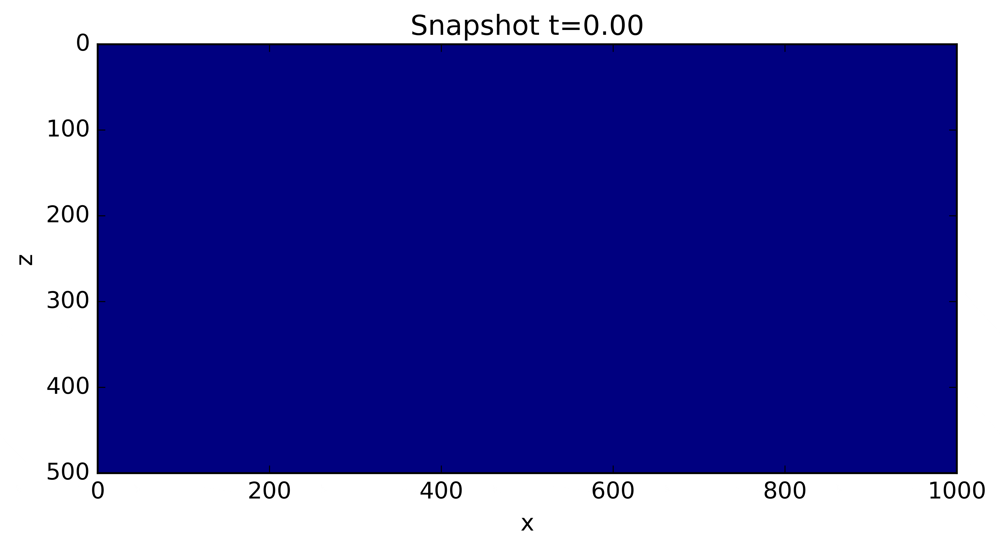
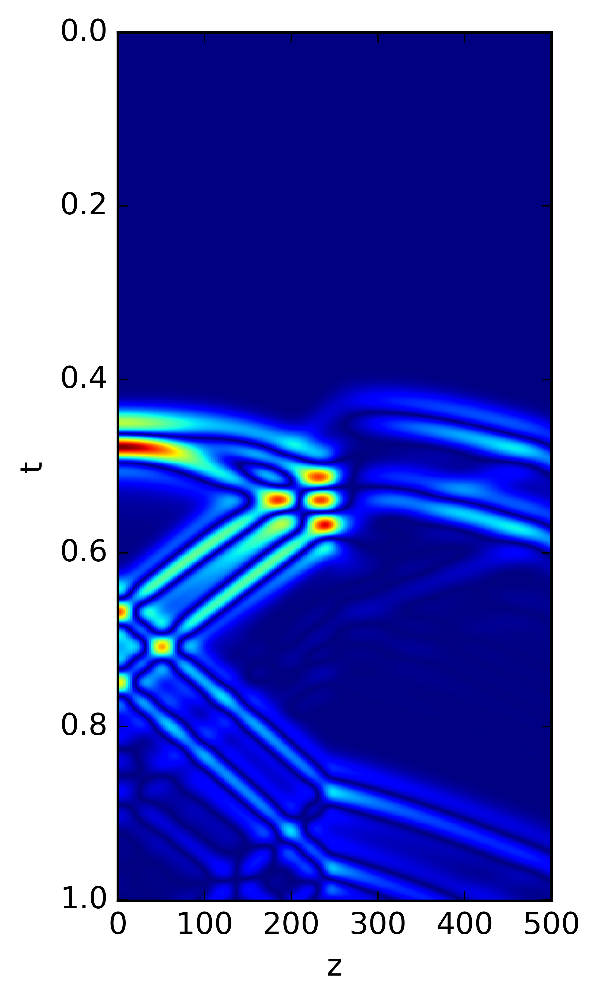
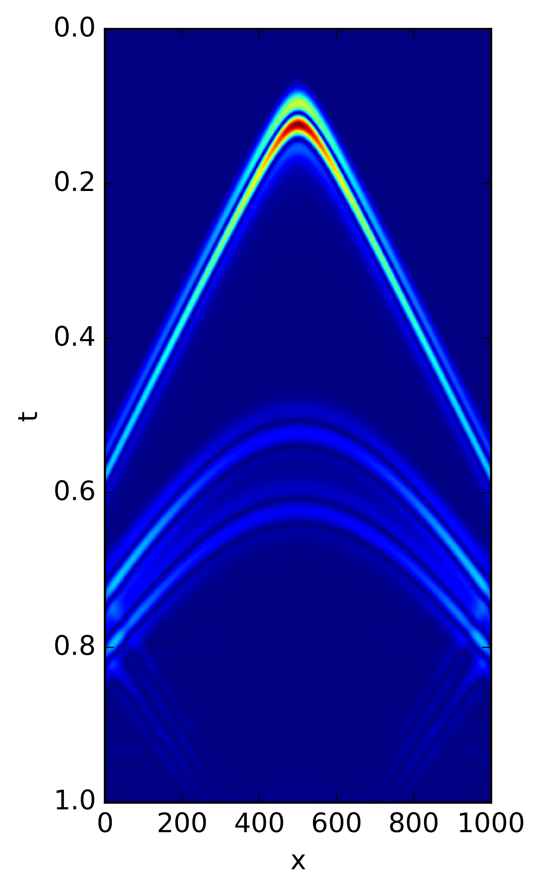

# Underground explosion
> [Project](../doc/INF431-Project.pdf) of the course "INF431 : Concurrency" at École Polytechnique

The objective of this project is to simulate the explosion of a bomb in a heterogeneous ground to study the propagation of the acoustic wave. And the programming language we use is JAVA.

## Mathematical Problem

We are interested in a simplified model and the problem turns into an acoustic wave equation problem.

### Equation

$$\frac{1}{c(\mathbf{x})^2}\frac{\partial^2 u}{\partial t^2}(t,\mathbf{x})-\Delta u(t,\mathbf{x})=S(t,\mathbf{x})$$

where $$\mathbf{x}=(x,y,z)\in\Omega$$, $$u$$ is the pressure, $$c$$ is the speed of sound and $$S$$ is the signature of the source :

$$S(t,\mathbf{x}) = 1_{t\in[0,T_s]}\cdot\delta(\mathbf{x}-\mathbf{x}_s)\cdot A[1-2\pi^2(f_ct-1)^2]e^{-\pi^2(f_ct-1)^2}$$

which means that it's a punctual source at $$\mathbf{x}_s$$ and the duration is $$[0,T_s]$$. Here $$f_c$$ is the characteristic frequency of the explosion.

### Initial Condition
As in the case of petroleum prospection, we consider the medium is at rest at the initial moment, i.e.

$$u(0,\mathbf{x})=\frac{\partial u}{\partial t}(0,\mathbf{x})=0$$

### Boundary Condition
We consider two types of boundary conditions :
1. Neumann Boundary Condition for the ground surface

    $$\frac{\partial u}{\partial n}(t,\mathbf{x})=0$$

2. Zero-order Absorbing Boundary Condition [(article)](https://hal.inria.fr/hal-00799759/) for other boundaries

    $$\frac{\partial u}{\partial t}(t,\mathbf{x})+c(\mathbf{x})\frac{\partial u}{\partial n}(t,\mathbf{x})=0$$

## Numerical Scheme
The given subject propose a $$2m$$-th order finite difference scheme which uses $$(2m)^d+1$$ points to approach $$\Delta u$$.

In order to simplify our problem, we consider the following second order scheme for the moment:

### Equation

$$\frac{1}{c_{i,j,k}^2}\frac{u_{i,j,k}^{n+1}-2u_{i,j,k}^{n}+u_{i,j,k}^{n-1}}{\Delta t^2}-((D^2_xu^n)_{i,j,k}+(D^2_yu^n)_{i,j,k}+(D^2_zu^n)_{i,j,k})=S_{i,j,k}^n$$

where

$$(D^2_xu^n)_{i,j,k} = \frac{u_{i+1,j,k}^n-2u_{i,j,k}^n+u_{i-1,j,k}^n}{\Delta x^2}$$

### Initial Condition

$$u_{i,j,k}^0=u_{i,j,k}^1=0$$

### Boundary Condition
1. Neumann Boundary Condition for the ground surface, $$\mathbf{n}=\mathbf{e}_z$$,

    $$\frac{u_{i,j,k+1}^n-u_{i,j,k-1}^n}{2\Delta x}=0$$

2. Zero-order Absorbing Boundary Condition [(article)](https://hal.inria.fr/hal-00799759/) for other boundaries

    For example, $$\mathbf{n}=\mathbf{e}_x$$,

    $$\frac{u_{i,j,k}^{n+1}-u_{i,j,k}^n}{\Delta t}+c_{i,j,k}^n\frac{u_{i+1,j,k}^n-u_{i-1,j,k}^n}{2\Delta x}=0$$

## Data Structure and Parallelism

To calculate the solution with parallelism, we divide the Area into 8 SubAreas :

| SubArea 0 | SubArea 1 | SubArea 2 | SubArea 3 |
| SubArea 4 | SubArea 5 | SubArea 6 | SubArea 7 |

So each SubArea does the calculation locally. But from the finite difference method, we can find that in order to calculate $$u^{n+1}$$ at one point, we need $$u^{n}$$ and $$u^{n-1}$$ at the same point as well as $$u^{n}$$ in its neighbors or some boundary conditions.

That's why we build the four following class which allow an efficient parallel calculation :

1. Area

    Area contains the main function who initializes and launches the threads. We define all the parameters here as well as the functions to calculate the source $$S(t,\mathbf{x})$$.

2. SubArea

    SubArea is derived from Thread and it calculates the solution in its own subarea. It uses Barrier to control the progress of threads.

3. UList

    We use UList to store the solution. UList contains a list of double arrays and each double array corresponds to the solution in one subarea. UList also contains some methods which realise the communication between threads since all the threads share the instances of UList.

4. Barrier

    We use Barrier class to realize the synchronization : each thread should wait for others before entering the next loop.

To sum up, the process of the calculation is :

`Area`

1. Define the parameters of equation and of parallelism

2. Open the files where we stock the snapshots and seismograms

3. Initialize `UList u0, u1` with zero

4. Initialize and launch the instances of `SubArea`

    Each `SubArea` use a for loop to :

    1. Calculate $$u^{n+1}$$ from `u0, u1` which represent $$u^{n-1}$$, $$u^n$$

    2. Use `Barrier` to synchronize

    3. Store the snapshots and seismograms

    4. Update the references in `u0, u1`

    5. Use `Barrier` to synchronize

5. Wait all threads

6. Close the files

## Experience

For now, we studied only the 2D problem :

$$\mathbf{x}=(x,z)\in[0,1000]\times[0,500]$$

The area is heterogeneous and the speed of sound is defined as :

$$c(z) = \begin{cases}
        1000 & z \in [0,250]\\
        2000 & z \in (250,500]
        \end{cases}$$

The bomb explodes at $$\mathbf{x}_s=(x,z)=(500,50)$$ and the parameters of its signature are $$A=1,f_c=15,T_s=0.2$$.

The time step is $$\Delta t=0.0002$$ and the space step is $$h=2$$.

With this setting, the code takes about 28 seconds to calculate until $$t=1$$ over a computer with CPU i7-5500U @ 2.40 GHz.

### Snapshots

The snapshots of solution for $$t=0:0.02:0.6$$

- From the gif above, we can see clearly the reflection of waves due to the Neumann boundary condition of the surface and the change of medium at $$z=250$$.

- Thanks to the absorbing boundary condition that we use, there is no reflection for the other three boundaries.

### Seismograms

The seismograms for $$x=100$$ (left) and $$z=0$$ (right).

## Conclusion

We have simulated a simple 2D problem by using JAVA Threads.

In the future, we can

- Simulate a 3D problem
- Use a high order scheme
- Use GPU to calculate
- etc.

At last, I'd like to thank my friend Kevin for his kind cooperation in this project.

## Code

[GitHub Repository](https://github.com/mathpluscode/2A-INF431-Project)
