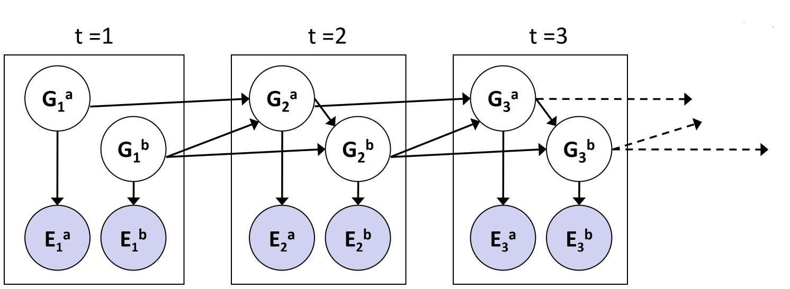
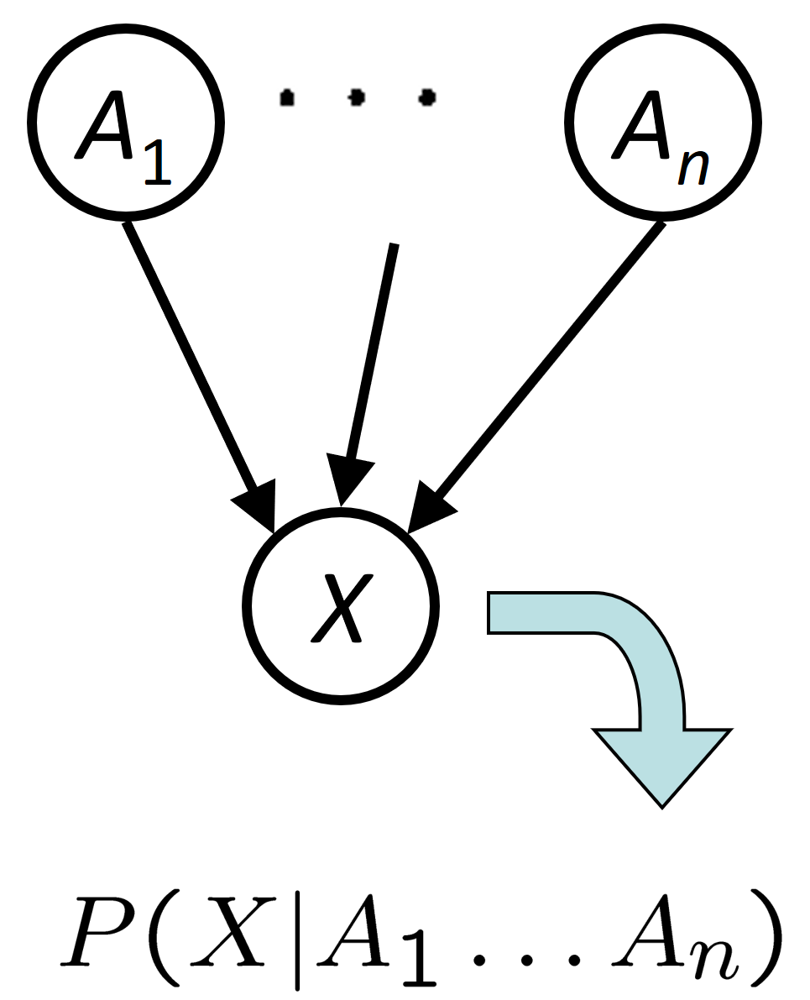
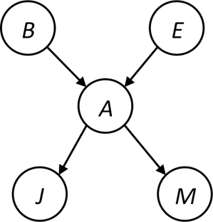
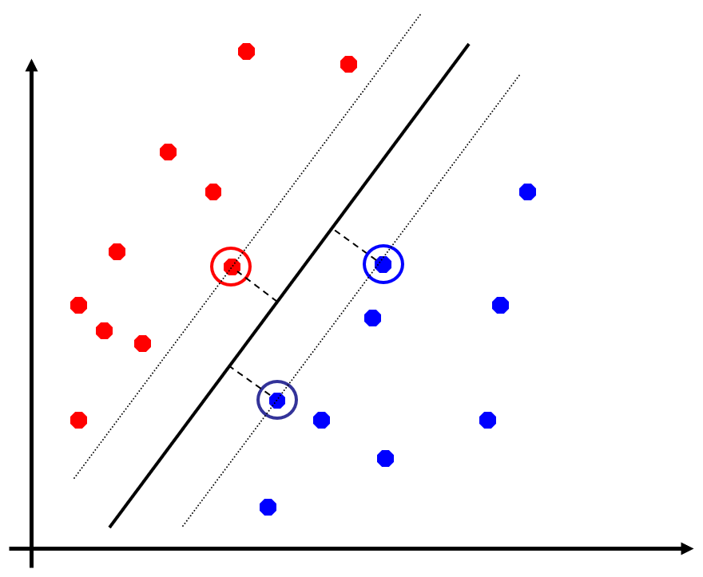

# Intro to AI
> [http://ai.berkeley.edu](http://ai.berkeley.edu)

<br>

---

# Search

- Search problem
    - a state space
    - a successor function (with actions, costs)
    - a start state and a goal test
- Solution
    >   A solution is a sequence of actions (a plan) which transforms the start state to a goal state
- State Space Graphs
- Search Trees

- Search Strategy
    1. Depth-First Search
    1. Breast-First Search
    1. Iterative deepening
        > run a DFS with a depth limit

    1. Uniform Cost Search (Best-First)
        > expand a cheapest node first

    1. A* Search
        > combine UCS and Greedy
        
        Cost f(n) = g(n) + h(n) where g(n) is path-cost (backward) and h(n) is goal proximity (forward)

        - Admissibility :
            
            heuristic h is admissible if 0 <= h(n) <= h*(n) := the true cost to a nearest goal

        - Consistency :
            
            h(A) - h(C) <= cost(A to C)

<br>

---

# Constraint Satisfaction Problems

- Search problem
    - Initial state
    - Successor function : assign a value to an unassigned variable
    - Goal test

- Search Strategy
    - Backtracking Search
        > DFS + variable-ordering + fail-on-violation

        - One variable a time
        - Check constraints as you go
    - Forward Checking
        - Keep track of domains for unassigned variables and cross off values that violate a constraint when added to the existing assignment
    - Consistency
        - Arc Consistency
            > An arc X -> Y is consistent iff for every x in the tail there is some y in the head which could be assigned without violating a constraint, if there is no such y, delete x

        - K-Consistency
            > For each k nodes, any consistent assignment to k-1 can be extended to the kth node.

        - Strong K-Consistency
            > Also K-1, K-2, ..., 1 consistent

    - Ordering
        - Minimum remaining values (MRV)
            >   Choose the variable with the fewest legal left values in its domain

        - Least Constraining Value
            >   Choose the value that rules out the fewest values in the remaining variables

    - Subproblems
    - Cutset
        > try all possibilities of several variables and solve the subproblems
    - Beam Search

<br>

---

# Adversarial Search

## Types

1. Zero-Sum Games
    > Agents have opposite utilities

2. General Games
    > Agents have independent utilities

## Strategy

1. MiniMax avec Alpha-Beta Pruning
    
    > MAX -> MIN -> MAX -> ... -> Utility

    - alpha : MAX's best utility on path to root
    - beta : MIN's best utility on path to root
    - Algo
        - If the state is a terminal state, return the state's utility
        - If the next agent is MAX, return the max utility of its successors : max-value(state, alpha, beta)
        - If the next agent is MIN, return the min utility of its successors : min-value(state, alpha, beta)
    - Problem
        Like DFS, it costs too much. So we can do depth-limited search (or iterative deepening, etc.) and replace terminal utilities with an evaluation function

        In practice, the evaluation function is a weighted linear sum of features.

2. Expectimax Search

    > MAX -> EXP -> MAX -> EXP -> ... -> Utility

    Values now reflect average-case (expectimax) outcomes, not worst-case (minmax) outcomes.

    - Algo
        - If the state is a terminal state, return the state's utility
        - If the next agent is MAX, return the max utility of its successors : max-value(state)
        - If the next agent is EXP, return the min utility of its successors : exp-value(state)

## Utility
> Utility Theorem [Ramsey, 1931; von Neumann & Morgenstern, 1944]

Rational Preferences
- Orderability

    A > B or A < B or A ~ B

- Transitivity

    A > B and B > C => A > C

- Continuity

    A > B > C => exists p such that [p, A; 1-p,C] ~ B

- Substitutability

    A ~ B => [p, A; 1-p,C] ~ [p, B; 1-p,C]

- Monotonicity

    A > B => ( p >=q <=> [p, A; 1-p,B] >= [q, A; 1-q,B] )

<br>

---

# Markov Decision Processes

| Problem | Goal | Tech |
| --- | --- | --- |
| Known MDP (offline) | Compute $$V^*,Q^*,\pi^*$$ | Value / Policy iteration |
| | Evaluate a fixed policy $\pi$ | Policy evaluation |
| Unknown MDP Model-Based | Compute $$V^*,Q^*,\pi^*$$ | Value / Policy iteration on approx. MDP |
| | Evaluate a fixed policy $\pi$ | Policy evaluation on approx MDP |
| Unknown MDP Model-Free | Compute $$V^*,Q^*,\pi^*$$ | Q-learning |
| | Evaluate a fixed policy $\pi$ | Value learning |


## Markov Decision Processes
> "Markov" generally means that given the present state, the future and the past are independent

- State $s$ in $S$
- Action $a$ in $A$
- Transition function $T(s,a,s')$
    > i.e., Probability that a from s leads to $s'$, $P(s'\|s,a)$
- Reward function $R(s,a,s')$
- Start state
- (Terminal state)

## Offline (T, R known)

> state $s$ -> take action $a$ -> q-state $(s,a)$ -> transition $(s,a,s')$ -> state $s'$

- Policy
    > In deterministic single-agent search problems, we wanted an optimal plan, or sequence of actions, from start to a goal.
    > 
    > Expectimax computes the action for a single state only.
    > 
    > But for MDPs, we want an optimal policy which gives an action for each state and maximizes expected utility if followed.

    $\pi^*(s)$ = optimal action from state $s$

- Utility (value)
    > Sum of (discounted) rewards
    > 
    > Value of rewards decay exponentially with parameter gamma in $(0,1]$

    - The value of a state $s$:
        
        The expected utility starting in $s$ and acting optimally is

        $$V^*(s) = \max_a Q^*(s,a)$$

    - The value of a q-state (s,a):

        The expected utility starting out having taken action a from state $s$ and (thereafter) acting optimally is

        $$Q^*(s,a) = \sum_{s'} T(s,a,s') [R(s,a,s') + \gamma V^*(s')]$$

### Algo
> Bellman updates

1. Value Iteration
    > Asynchronous Value Iteration :
    > 
    > Here we update every state in each iteration. Actually, any sequences of Bellman updates will converge if every state is visited infinitely often. 

    - Initialization $V_0(s) = 0$
    - Iteration
    
        $$ V_{k+1}(s) = \max_a Q_k(s,a) = \max_a \sum_{s'} T(s,a,s') [R(s,a,s') + \gamma V_k(s')] $$

1. Policy Iteration
    
    Repeats policy evaluation - policy improvement until policy converges
    
    - Policy Evaluation
        > Compute the utility of states under a fixed policy

        $$V(s) = \sum_{s'} T(s,\pi(s),s') [R(s,\pi(s),s') + \gamma V(s')]$$

        - Iteration
        - Linear System Solver
               
    - Policy Improvement (Extraction) (one-step lookahead)
        > Extract a policy by doing mini-expectimax from values

        $$\pi(s) = \arg\max_a Q(s,a) = \arg\max_a \sum_{s'} T(s,a,s') [R(s,a,s') + \gamma V(s')]$$

## Reinforcement Learning (T or R unknown)

- Learn an empirical MDP model
- Solve the learned MDP

1. Direct Evaluation
    > Compute values under a fixed policy $\pi$

    - Act according to $\pi$
    - Note rewards $R(s,a,s')$ when we experience $(s,a,s')$
    - Average samples

    Problems:
    - Need to learn each state separately and it takes a long time
    - It wastes information about state connections

1. Temporal Difference Learning (Value learning)
    > Compute values under a fixed policy $\pi$

    - Act accoring to $\pi$ to receive a sample ($a = \pi(s)$)
        
        $$(s,a,s',R(s,a,s'))$$

    - Update $V(s)$
        1. $\text{sample} = R(s,a,s') + \gamma V'(s)$
        1. $V(s) = V(s) + \alpha (\text{sample} - V(s))$

    Problem:
    - Can't turn values into a new policy because we learn values instead of Q-values

1. Q Learning

    Instead of computing $V(s)$
    
    $$V(s) = \max_a \sum_{s'} T(s,a,s')[R(s,a,s') + \gamma V(s)]$$
    
    We compute $Q(s)$
    
    $$Q(s) = \sum_{s'} T(s,a,s')[R(s,a,s') + \gamma \max_{a'} Q(s',a')]$$

    - Act accoring to $\pi$ to receive a sample ($a = \pi(s)$)
        
        $$(s,a,s',R(s,a,s'))$$

    - Update $Q(s,a)$
        1. $\text{sample} = R(s,a,s') + \gamma \max_a Q(s',a')$
        1. $Q(s,a) = Q(s,a) + \alpha (\text{sample} - Q(s,a))$

    Problem:
    - We need to keep a table of all Q-values

    Solution:
    - We can use a vector of features to describe a state

        $$Q(s,a) = w_1 f_1(s,a) + w_2 f_2(s,a) + ... + w_n f_n(s,a)$$

        Often the feature-based policies that work well aren't the ones that approximate V/Q best. Need to learn policies that maximize rewards, not the values that predict them.

1. Exploration

    1. Acts randomly with probability eps (eps decreases over time)

    1. Exploration functions
        > Takes a value estimate u and a visit count n, and returns an optimistic utility

        $f(u, n) = u + \frac{k}{n}$

        - Regular Q-update : $\text{sample} = R(s,a,s') + \gamma \max_a Q(s',a')$
        - Modified Q-update : $\text{sample} = R(s,a,s') + \gamma \max_a f(Q(s',a'), N(s',a'))$

---

# Probability

- Bayes' Rule
    - $P(x,y) = P(x\|y) P(y) = P(y\|x) P(x)$
    - $P(x\|y) = P(y\|x) P(x) P^{-1}(y)$

- Conditional Independence
    
    $X$ is conditionally independent of $Y$ given $Z$

    - $P(x,y\|z) = P(x\|z)P(y\|z)$
    - $P(x\|z,y) = P(x\|z)$

- Markov Model

    ```
    X1 -> X2 -> X3 -> ...
    ```

    $P(X_1,X_2,...,X_T) = P(X_1)P(X_2\|X_1)...P(X_T\|X_{T-1})$

<br>

---

# Hidden Markov Model

```
X1 -> X2 -> X3 -> ...
|     |     |
E1    E2    E3
```

$$P(X_1,E_1,...,X_T,E_T) = P(X_1)P(E_1|X_1) P(X_2|X_1)P(E_2|X_2) \cdots P(X_T|X_{T-1})P(E_T|X_T)$$

- State independent of all past states and all past evidence given the previous state
- Evidence is independent of all past states and all past evidence given the current state
    > But the evidence variables are not independent. They are correlated by hidden states.
- Past variables independent of future variables given the present
    > if $t_1 < t_2 < t_3$ then $X_{t_1}$ is conditionally independent of $X_{t_3}$ given $X_{t_2}$

## Forward Algorithm
> Track the distribution $B(X_t) = P_t(X_t\|e_{1:t})$ over time

- Initialization:
    
    Start with $B_1(X)$, usually uniform

- Passage of time:

$$P(X_{t+1}|e_{1:t}) = \sum_{x_t} P(X_{t+1}|x_t)P(x_t|e_{1:t})$$

- Observation:

$$B(X_{t+1}) = P(X_{t+1}|e_{1:t},e_{t+1}) \propto P(e_{t+1}|X_{t+1})P(X_{t+1}|e_{1:t})$$

Problem:

- When $\|X\|$ is too big or when $X$ is continue, we can't store all $B(X)$

## Viterbi Algorithm
> For responding queries like most likely explanation :
> 
> $$\arg\max_{x_{1:t}} P(x_{1:t} | e_{1:t})$$

Passage of time and observation: (use max instead of sum)

$$P(X_{t+1}|e_{1:t},e_{t+1}) = P(e_{t+1}|X_{t+1}) \max_{x_t} P(X_{t+1}|x_t)P(x_t|e_{1:t})$$

## Particle Filtering

Use particles to present the probability distribution

- Initialization:
    
    Start with a distribution (usually uniform) and set $N$ particles randomly according to the distribution.

- Passage of time:

    Each particle is moved by sampling its next position from the transition model.
    (Each particle moves randomly according to the transition model $P (X'\|x)$)

    $$x'=\text{sample}(P(X'|x))$$

- Observation:

    - Downweight samples based on the evidence.

    $$w(x) = P(e|x)$$

    - Resample the particles :
    
    Choose from the weighted sample distribution $N$ times (i.e. draw with replacement).

<br>

---

# Dynamic Bayes Nets



- Initialization

    Generate prior samples for the t=1 Bayes net

- Passage of time

    Sample a successor for each particle

- Observation
    - Downweight

        Weight each *entire* sample by the liklyhood of the evidence conditioned on the sample

        $$P(E_1^a|G_1^a)P(E_1^b|G_1^b)$$

    - Resample

        Select prior samples (tuples of values) in proportion to their likelihood

<br>

---

# Bayes Nets



## Definitions
- A set of nodes, one per variable X

- A directed, acyclic graph

- Local Markov property
    
    Each variable is conditionally independent of its non-descendants given its parent variables.

    This is equivalent to the following factorization definition:

    $$P(x_1,\cdots,x_n)=\prod_{i=1}^{n}P(x_i|\text{parents}(X_i))$$

## Conditional Independence

### Causual Chains

```
X -> Y -> Z
```

- X is not necessary independent of Z (active)
- X is independent of Z given Y (inactive)
    > Evidence along the chain "blocks" the influence

### Common Cause

```
Y -> X
  -> Z
```
- X is not necessary independent of Z (active)
- X is independent of Z given Y (inactive)
    > Observing the cause blocks influence between effects

### Common Effect

```
X -> Z
Y ->
```

- X and Y are independent (inactive)
- X is not necessary independent of Y given Z (active)
    > Observing an effect activates influence between possible causes

```
X -> P -> ... -> Z
Y ->
```

- X is not necessary independent of Y given Z (active)

### General case

Are X and Y conditionally independent given evidence variables Z ?

Consider all (undirected) paths from X to Y, if there is no active paths, then X and Y are conditionally independent ! If there is an active path, the independence is not guaranteed. (But it may be independent)

A path is active if each triple is active (independence not guaranteed ).

### Topology limits distributions

Given some graph topology G, the graph structure guarantees certain (conditional) independences and only certain joint distributions can be encoded.

## Inference

We want to know $P(Q\|e_1,\cdots,e_k)$

where all variables $X_1,\cdots,X_n$ can be divided into three types

- Evidence variables $E_1,\cdots,E_k = e_1,\cdots,e_k$
- Query variable $Q$
- Hidden variables $H_1,\cdots,H_r$

So $P(Q\|e_1,\cdots,e_k)=\sum\limits_{h_1,\cdots,h_r}P(Q\|h_1,\cdots,h_r,e_1,\cdots,e_k)$

### Example
```
R -> T -> L
```

We have $P(R), P(T\|R), P(L\|T)$ and we want to know $P(L)$

- Inference by enumeration

    $$P(L)=\sum\limits_t\sum\limits_r P(L|t)P(t|r)P(r)$$

    1. $P(R), P(T\|R) \rightarrow P(R,T)$

    1. $P(R,T),P(L\|T) \rightarrow P(R,T,L) \rightarrow P(L)$

- Variable elimination

    $$P(L)=\sum\limits_t P(L|t) \sum\limits_r P(t|r)P(r)$$

    1. $P(R), P(T\|R) \rightarrow P(R,T) \rightarrow P(T)$

    1. $P(T),P(L\|T) \rightarrow P(T,L) \rightarrow P(L)$

### General Variable Elimination

$P(Q\|E_1=e_1,\cdots,E_k=e_k)$

- Start with local CPTs (conditionaly probability table) which are instantiated by evidence

- While there are still hidden variables (not query variable or evidence)

    - Pick a hidden variable H
    - Join all factors mentionubg H
    - Eliminate (sum out) H

- Join all remaining factors and normalize

The elimination ordering can greatly affect the size of the largest factor. And for poly-trees (directed graph with no undirected cycles) we can always find an efficient ordering. For other graphs, we can try to choose a set of variables such that if removed only a polytree remains.

### General Example



Given $P(B), P(E), P(A\|B,E), P(j\|A), P(m\|A)$, we want to know $P(B\|j,m)$

1. Choose A
    - Join A
    
        $P(A\|B,E), P(j\|A), P(m\|A) \rightarrow P(j,m,A\|B,E)$

    - Eliminate A
    
        $P(j,m,A\|B,E) \rightarrow P(j,m\|B,E)$

1. Choose E
    - Join E
    
        $P(E), P(j,m\|B,E) \rightarrow P(j,m,E\|B)$
        
    - Eliminate E
        
        $P(j,m,E\|B) \rightarrow P(j,m\|B)$

1. Choose B
    - Join B
    
        $P(B), P(j,m\|B) \rightarrow P(j,m,B)$
        
    - Normalize
        
        $P(j,m,B) \rightarrow P(B\|j,m)$

## Sampling

Why sampling ?

- Learning: get samples from a distribution we don't know
- Inference: getting a sample is faster than computing the right answer

### Prior Sampling

- For $i=1:n$
    
    Sample $x_i$ from $P(X_i \| \text{Parents}(X_i))$

- Return $(x_1,\cdots,x_n)$

### Rejection Sampling

> If there are evidences, we reject inconsistent samples.
>
> If evidence is unlikely, rejects lots of samples.

- For $i=1:n$
    
    Sample $x_i$ from $P(X_i \| \text{Parents}(X_i))$

    If $x_i$ is inconsistent with evidence, return and no sample is generated

- Return $(x_1,\cdots,x_n)$

### Likelihood Weighting

> Fix evidence variables and sample the rest
>
> Evidence influences the choice of downstream variables, but not upstream ones (it isn't more likely to get a value matching the evidence)
>
> The weight can be very small and sum of weights over all samples is indicative of how many "effective" samples were obtained, so want high weight.

- $w=1$
- For $i=1:n$
    
    - If $X_i = x_i$ is an evidence variable

        $w = w \times P(x_i \| \text{Parents}(X_i))$
    
    - else

        Sample $x_i$ from $P(X_i \| \text{Parents}(X_i))$

- Return $(x_1,\cdots,x_n), w$

### Gibbs Sampling

> Gibbs sampling is a special case of more general methods called Markov chain Monte Carlo (MCMC) methods and Metropolis-Hastings is one of the more famous MCMC methods

- Fix evidences
- Initialize other variables randomly
- Repeat several times
    - Choose a non-evidence variable $X$ randomly
    - Resample $X$ from $P( X \| \text{all other variables})$
        > In fact, only CPTs that have resampled variable need to be considered, and joined together
- Return $(x_1,\cdots,x_n)$

## Value of Information
> MEU = Maximum Expected Utility
>
> VPI = Value of Perfect Information

- Assume we have evidence $E = e$, if we act now the value is:

    $$\text{MEU}(e) = \max\limits_a \sum\limits_s P(s|e)U(s,a)$$

    where $s$ is the parent of utility node and $a$ is the action.

- Assume we now see that $E' = e'$, if we act then the value is

    $$\text{MEU}(e,e') = \max\limits_a \sum\limits_s P(s|e,e')U(s,a)$$

- BUT $E'$ is a random variable whose value is unknown, so we don't know what $e'$ will be.

    If $E'$ is revealed and then we act:

    $$\text{MEU}(e,E') = \sum\limits_{e'} P(e'|e)\text{MEU}(e,e')$$

- So the value of information $E'$: how much MEU goes up by revealing E' first:

    $$\text{VPI}(E'|e)=\text{MEU}(e,E')-\text{MEU}(e)$$

### VPI Properties

- Nonnegative

    $$\forall E',e,\quad \text{VPI}(E'|e)\geq 0$$

- Nonadditive
    > i.e. if we observe a same evidence twice, VPI doesn't change

    $$\text{VPI}(E_j,E_k|e)\neq \text{VPI}(E_j|e)+\text{VPI}(E_k|e)$$

- Order-independent

    $$\text{VPI}(E_j,E_k|e) = \text{VPI}(E_j|e)+\text{VPI}(E_k|e,E_j) = \text{VPI}(E_k|e)+\text{VPI}(E_j|e,E_k)$$

- If the observed evidence is conditionally independent to the parents of utility given current evidences, then VPI = 0.

<br>

---

# POMDP
> Partially Observable Markov Decision Process
> 
> The agent cannot directly observe the underlying state.

<br>

---

# Naïve Bayes
> Classification

$$P(Y,F_1,\cdots,F_n)=P(Y)\prod\limits_iP(F_i|Y)$$

The idea is that each feature depends on the class.

To use Naïve Bayes, we need to calculate $P(Y\|f_1,\cdots,f_n)$ by using $P(y_k,f_1,\cdots,f_n)$.

## Naïve Bayes for Text

$$P(Y,W_1,\cdots,W_n)=P(Y)\prod\limits_iP(W_i|Y)$$

Feature $W_i$ is the word at position $i$ and we assume that all positions share the same conditional probability $P(W\|Y)$

To calculate a conditional probability $P(x\|y)$:

- Maximum Likelihood:

    $P(x\|y) = \frac{\text{count}(x,y)}{\text{count}(y)}$

- Maximum Likelihood:

    $P(x\|y) = \alpha \hat{P}(x\|y) + (1-\alpha) \hat{P}(x)$

- Laplace Smoothing:

    $P(x\|y) = \frac{\text{count}(x,y)+k}{\text{count}(y)+k\|X\|}$

<br>

---

# Perceptrons

## Linear, Oneclass

Use $\text{sgn}(w^Tf(x))$ to classify instance

- $w=0$
- For each training instance
    - $y=\text{sgn}(w^Tf(x))$
    - If $y$ is different from the exact label $y^*$

        $w=w+y^*f(x)$

## Linear, Multiclass

There are different weights $w_y$ and we use $\arg\max\limits_y {w_y}^Tf(x)$ to classify instance

- $w_y=0$ for all class
- For each training instance
    - $y=\arg\max\limits_y {w_y}^Tf(x)$
    - If $y$ is different from the exact label $y^*$

        $w_{y}=w_{y}-f(x), \quad w_{y^\*}=w_{y^\*}+f(x)$

## MIRA (Margin Infused Relaxed Algorithm)
> To prevent overfitting

Try to minimize the change to weight

$$\min\limits_w \frac{1}{2}\sum\limits_y\|w_y-w_{y}'\|^2$$

such that

$$w_{y^*}^T f(x) \geq w_y^T f(x) + 1$$

If we consider change like:

$$w_{y}=w_{y}'-\gamma f(x), \quad w_{y^*}=w_{y^*}'+\gamma f(x)$$

problem becomes:

$$\min\limits_\gamma \|\gamma f(x)\|^2$$

such that 

$$(w_{y^*}'+\gamma f(x))^T f(x) \geq (w_y'-\gamma f(x))^T f(x) + 1$$

and so

$$\gamma = \frac{(w_y'-w_{y^*}')^T f(x)+1}{2f(x)^T f(x)}$$

In practice, it's bad to make updates that are too large so we can cap the maximum possible value of $\gamma$ with some constant $C$:

$$\gamma = \min(\gamma, C)$$

## SVM (Support Vector Machines)



$$\min\limits_w \frac{1}{2}\|w\|^2$$

such that

$$\forall i,y \quad w_{y^*}^T f(x_i) \geq w_y^T f(x_i) + 1$$

The goal is to maximize the margin for all instances. Different from MIRA which optimize for an instance and try to minimize the size of change.

This algorithm 
(with kernel) can be used for online learning by using prime/dual problem.

> Bordes, Antoine, et al. "Fast kernel classifiers with online and active learning." Journal of Machine Learning Research 6.Sep (2005): 1579-1619.

## Kernel Trick

For a perceptron, the weight is in fact a linear combination of features $f(x_i)$:

$$w_y = \sum\limits_i \alpha_{i,y} f(x_i)$$

So $w_y^T f(x) = \sum\limits_i \alpha_{i,y} f(x_i)^Tf(x) = \sum\limits_i \alpha_{i,y} K(x_i,x)$

Kernels:
- Linear Kernel: $K(x_1,x_2)=x_1^Tx_2$
- Quadratic Kernel: $K(x_1,x_2)=(x_1^Tx_2+1)^2$
- RBF: $K(x_1,x_2)=\exp(-\gamma\|x_1-x_2\|^2)$
- Discrete Kernel: e.g. string kernel