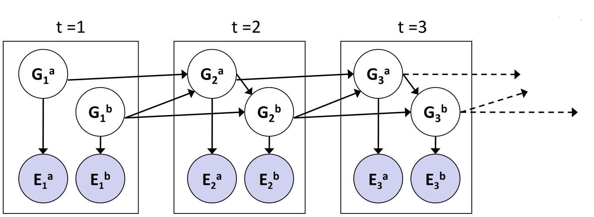

# UC Berkeley CS188 Intro to AI
> [http://ai.berkeley.edu](http://ai.berkeley.edu)

<br>

---

## Search

- Search problem
    - a state space
    - a successor function (with actions, costs)
    - a start state and a goal test
- Solution
    >   A solution is a sequence of actions (a plan) which transforms the start state to a goal state
- State Space Graphs
- Search Trees

- Search Strategy
    1. Depth-First Search
    1. Breast-First Search
    1. Iterative deepening
        > run a DFS with a depth limit

    1. Uniform Cost Search (Best-First)
        > expand a cheapest node first

    1. A* Search
        > combine UCS and Greedy
        
        Cost f(n) = g(n) + h(n) where g(n) is path-cost (backward) and h(n) is goal proximity (forward)

        - Admissibility :
            
            heuristic h is admissible if 0 <= h(n) <= h*(n) := the true cost to a nearest goal

        - Consistency :
            
            h(A) - h(C) <= cost(A to C)

<br>

---

## Constraint Satisfaction Problems

- Search problem
    - Initial state
    - Successor function : assign a value to an unassigned variable
    - Goal test

- Search Strategy
    - Backtracking Search
        > DFS + variable-ordering + fail-on-violation

        - One variable a time
        - Check constraints as you go
    - Forward Checking
        - Keep track of domains for unassigned variables and cross off values that violate a constraint when added to the existing assignment
    - Consistency
        - Arc Consistency
            > An arc X -> Y is consistent iff for every x in the tail there is some y in the head which could be assigned without violating a constraint, if there is no such y, delete x

        - K-Consistency
            > For each k nodes, any consistent assignment to k-1 can be extended to the kth node.

        - Strong K-Consistency
            > Also K-1, K-2, ..., 1 consistent

    - Ordering
        - Minimum remaining values (MRV)
            >   Choose the variable with the fewest legal left values in its domain

        - Least Constraining Value
            >   Choose the value that rules out the fewest values in the remaining variables

    - Subproblems
    - Cutset
        > try all possibilities of several variables and solve the subproblems
    - Beam Search

<br>

---

## Adversarial Search

### Types

1. Zero-Sum Games
    > Agents have opposite utilities

2. General Games
    > Agents have independent utilities

### Strategy

1. MiniMax avec Alpha-Beta Pruning
    
    > MAX -> MIN -> MAX -> ... -> Utility

    - alpha : MAX's best utility on path to root
    - beta : MIN's best utility on path to root
    - Algo
        - If the state is a terminal state, return the state's utility
        - If the next agent is MAX, return the max utility of its successors : max-value(state, alpha, beta)
        - If the next agent is MIN, return the min utility of its successors : min-value(state, alpha, beta)
    - Problem
        Like DFS, it costs too much. So we can do depth-limited search (or iterative deepening, etc.) and replace terminal utilities with an evaluation function

        In practice, the evaluation function is a weighted linear sum of features.

2. Expectimax Search

    > MAX -> EXP -> MAX -> EXP -> ... -> Utility

    Values now reflect average-case (expectimax) outcomes, not worst-case (minmax) outcomes.

    - Algo
        - If the state is a terminal state, return the state's utility
        - If the next agent is MAX, return the max utility of its successors : max-value(state)
        - If the next agent is EXP, return the min utility of its successors : exp-value(state)

### Utility
> Utility Theorem [Ramsey, 1931; von Neumann & Morgenstern, 1944]

Rational Preferences
- Orderability

    A > B or A < B or A ~ B

- Transitivity

    A > B and B > C => A > C

- Continuity

    A > B > C => exists p such that [p, A; 1-p,C] ~ B

- Substitutability

    A ~ B => [p, A; 1-p,C] ~ [p, B; 1-p,C]

- Monotonicity

    A > B => ( p >=q <=> [p, A; 1-p,B] >= [q, A; 1-q,B] )

<br>

---

## Markov Decision Processes

| Problem | Goal | Tech |
| --- | --- | --- |
| Known MDP (offline) | Compute $$V^*,Q^*,\pi^*$$ | Value / Policy iteration |
| | Evaluate a fixed policy $\pi$ | Policy evaluation |
| Unknown MDP Model-Based | Compute $$V^*,Q^*,\pi^*$$ | Value / Policy iteration on approx. MDP |
| | Evaluate a fixed policy $\pi$ | Policy evaluation on approx MDP |
| Unknown MDP Model-Free | Compute $$V^*,Q^*,\pi^*$$ | Q-learning |
| | Evaluate a fixed policy $\pi$ | Value learning |


### Markov Decision Processes
> "Markov" generally means that given the present state, the future and the past are independent

- State $s$ in $S$
- Action $a$ in $A$
- Transition function $T(s,a,s')$
    > i.e., Probability that a from s leads to $s'$, $P(s'\|s,a)$
- Reward function $R(s,a,s’)$
- Start state
- (Terminal state)

### Offline (T, R known)

> state $s$ -> take action $a$ -> q-state $(s,a)$ -> transition $(s,a,s')$ -> state $s'$

- Policy
    > In deterministic single-agent search problems, we wanted an optimal plan, or sequence of actions, from start to a goal.
    > 
    > Expectimax computes the action for a single state only.
    > 
    > But for MDPs, we want an optimal policy which gives an action for each state and maximizes expected utility if followed.

    $\pi^*(s)$ = optimal action from state $s$

- Utility (value)
    > Sum of (discounted) rewards
    > 
    > Value of rewards decay exponentially with parameter gamma in $(0,1]$

    - The value of a state $s$:
        
        The expected utility starting in $s$ and acting optimally is

        $$V^*(s) = \max_a Q^*(s,a)$$

    - The value of a q-state (s,a):

        The expected utility starting out having taken action a from state $s$ and (thereafter) acting optimally is

        $$Q^*(s,a) = \sum_{s'} T(s,a,s') [R(s,a,s') + \gamma V^*(s')]$$

Algo
> Bellman updates

1. Value Iteration
    > Asynchronous Value Iteration :
    > 
    > Here we update every state in each iteration. Actually, any sequences of Bellman updates will converge if every state is visited infinitely often. 

    - Initialization $V_0(s) = 0$
    - Iteration
    
        $$ V_{k+1}(s) = \max_a Q_k(s,a) = \max_a \sum_{s'} T(s,a,s') [R(s,a,s') + \gamma V_k(s')] $$

1. Policy Iteration
    
    Repeats policy evaluation - policy improvement until policy converges
    
    - Policy Evaluation
        > Compute the utility of states under a fixed policy

        $$V(s) = \sum_{s'} T(s,\pi(s),s') [R(s,\pi(s),s') + \gamma V(s')]$$

        - Iteration
        - Linear System Solver
               
    - Policy Improvement (Extraction) (one-step lookahead)
        > Extract a policy by doing mini-expectimax from values

        $$\pi(s) = \arg\max_a Q(s,a) = \arg\max_a \sum_{s'} T(s,a,s') [R(s,a,s') + \gamma V(s')]$$

### Reinforcement Learning (T or R unknown)

- Learn an empirical MDP model
- Solve the learned MDP

1. Direct Evaluation
    > Compute values under a fixed policy $\pi$

    - Act according to $\pi$
    - Note rewards $R(s,a,s')$ when we experience $(s,a,s')$
    - Average samples

    Problems:
    - Need to learn each state separately and it takes a long time
    - It wastes information about state connections

1. Temporal Difference Learning (Value learning)
    > Compute values under a fixed policy $\pi$

    - Act accoring to $\pi$ to receive a sample ($a = \pi(s)$)
        
        $$(s,a,s',R(s,a,s'))$$

    - Update $V(s)$
        1. $\text{sample} = R(s,a,s') + \gamma V(s)$
        1. $V(s) = V(s) + \alpha (\text{sample} - V(s))$

    Problem:
    - Can't turn values into a new policy because we learn values instead of Q-values

1. Q Learning

    Instead of computing $V(s)$
    
    $$V(s) = \max_a \sum_{s'} T(s,a,s')[R(s,a,s') + \gamma V(s)]$$
    
    We compute $Q(s)$
    
    $$Q(s) = \sum_{s'} T(s,a,s')[R(s,a,s') + \gamma \max_{a'} Q(s',a')]$$

    - Act accoring to $\pi$ to receive a sample ($a = \pi(s)$)
        
        $$(s,a,s',R(s,a,s'))$$

    - Update $Q(s,a)$
        1. $\text{sample} = R(s,a,s') + \gamma \max_a Q(s',a')$
        1. $Q(s,a) = Q(s,a) + \alpha (\text{sample} - Q(s,a))$

    Problem:
    - We need to keep a table of all Q-values

    Solution:
    - We can use a vector of features to describe a state

        $$Q(s,a) = w_1 f_1(s,a) + w_2 f_2(s,a) + ... + w_n f_n(s,a)$$

        Often the feature-based policies that work well aren't the ones that approximate V/Q best. Need to learn policies that maximize rewards, not the values that predict them.

1. Exploration

    1. Acts randomly with probability eps (eps decreases over time)

    1. Exploration functions
        > Takes a value estimate u and a visit count n, and returns an optimistic utility

        $f(u, n) = u + \frac{k}{n}$

        - Regular Q-update : $\text{sample} = R(s,a,s') + \gamma \max_a Q(s',a')$
        - Modified Q-update : $\text{sample} = R(s,a,s') + \gamma \max_a f(Q(s',a'), N(s',a'))$

---

## Probability

- Bayes' Rule
    - $P(x,y) = P(x\|y) P(y) = P(y\|x) P(x)$
    - $P(x\|y) = P(y\|x) P(x) P^{-1}(y)$

- Conditional Independence
    
    $X$ is conditionally independent of $Y$ given $Z$

    - $P(x,y\|z) = P(x\|z)P(y\|z)$
    - $P(x\|z,y) = P(x\|z)$

- Markov Model

    ```
    X1 -> X2 -> X3 -> ...
    ```

    $P(X_1,X_2,...,X_T) = P(X_1)P(X_2\|X_1)...P(X_T\|X_{T-1})$

<br>

---

## Hidden Markov Model

```
X1 -> X2 -> X3 -> ...
|     |     |
E1    E2    E3
```

$$P(X_1,E_1,...,X_T,E_T) = P(X_1)P(E_1|X_1) P(X_2|X_1)P(E_2|X_2) \cdots P(X_T|X_{T-1})P(E_T|X_T)$$

- State independent of all past states and all past evidence given the previous state
- Evidence is independent of all past states and all past evidence given the current state
    > But the evidence variables are not independent. They are correlated by hidden states.
- Past variables independent of future variables given the present
    > if $t_1 < t_2 < t_3$ then $X_{t_1}$ is conditionally independent of $X_{t_3}$ given $X_{t_2}$

### Forward Algorithm
> Track the distribution $B(X_t) = P_t(X_t\|e_{1:t})$ over time

- Initialization:
    
    Start with $B_1(X)$, usually uniform

- Passage of time:

$$P(X_{t+1}|e_{1:t}) = \sum_{x_t} P(X_{t+1}|x_t)P(x_t|e_{1:t})$$

- Observation:

$$B(X_{t+1}) = P(X_{t+1}|e_{1:t},e_{t+1}) \propto P(e_{t+1}|X_{t+1})P(X_{t+1}|e_{1:t})$$

Problem:

- When $\|X\|$ is too big or when $X$ is continue, we can't store all $B(X)$

### Viterbi Algorithm
> For responding queries like most likely explanation :
> 
> $$\arg\max_{x_{1:t}} P(x_{1:t} | e_{1:t})$$

Passage of time and observation: (use max instead of sum)

$$P(X_{t+1}|e_{1:t},e_{t+1}) = P(e_{t+1}|X_{t+1}) \max_{x_t} P(X_{t+1}|x_t)P(x_t|e_{1:t})$$

### Particle Filtering

Use particles to present the probability distribution

- Initialization:
    
    Start with a distribution (usually uniform) and set $N$ particles randomly according to the distribution.

- Passage of time:

    Each particle is moved by sampling its next position from the transition model.
    (Each particle moves randomly according to the transition model $P (X'\|x)$)

    $$x'=\text{sample}(P(X'|x))$$

- Observation:

    - Downweight samples based on the evidence.

    $$w(x) = P(e|x)$$

    - Resample the particles :
    
    Choose from the weighted sample distribution $N$ times (i.e. draw with replacement).

<br>

---

## Dynamic Bayes Nets



- Initialization
- Passage of time
- Observation
    - Downweight
    - Resample

# Notes until lecture 15