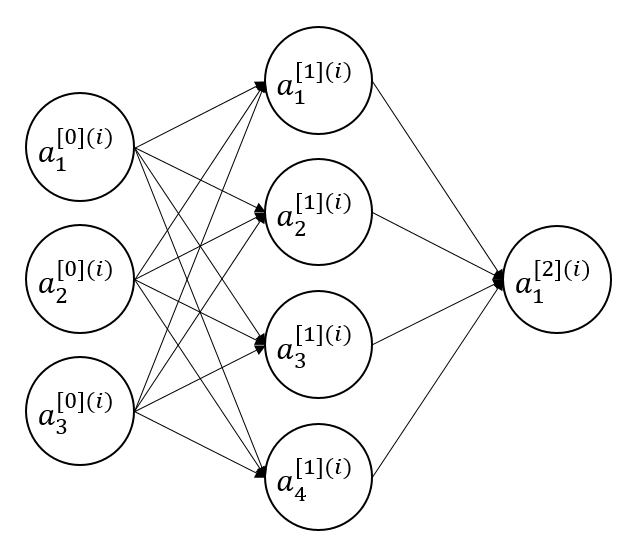
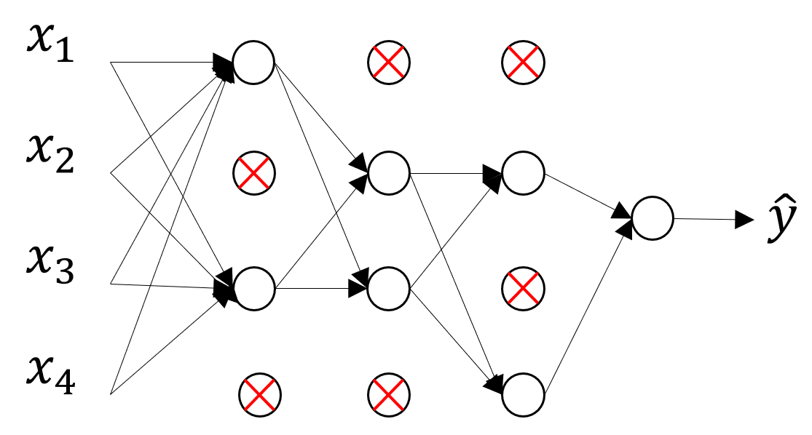
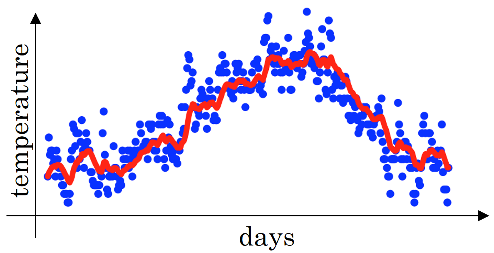

# Deep Learning Specialization
> [https://www.coursera.org/specializations/deep-learning](https://www.coursera.org/specializations/deep-learning)

 

---

# Neural Networks and Deep Learning

## Supervised Learning with Neural Networks

Examples:

| Input | Output | Application | Algorithm |
| --- | --- | --- | --- |
| Home features | Price | Real Estate | Standard NN |
| Ad, user info | Click on ad? (0/1) | Online Advertising | Standard NN |
| Image | Object (1,…,1000) | Photo tagging | Convolutional NN |
| Audio | Text transcript | Speech recognition | Recurrent NN |
| English | Chinese | Machine translation | Recurrent NN |
| Image, Radar info | Position of other cars | Autonomous driving | Hybrid |

## Logistic Regression as a Neural Network

$$w,b \quad\rightarrow\quad z=w^Tx+b \quad\rightarrow\quad a=\sigma(z) \quad\rightarrow\quad L(a,y)$$

Given $x$,

$$\hat{y}=a=\sigma(w^Tx+b)$$

with $\sigma(z)=\frac{1}{1+e^{-z}}$ and $\sigma'(z)=\sigma(z)(1-\sigma(z))$

Loss (error) function is:

$$L(a,y)=-(y\log a + (1-y)\log(1-a))$$

Cost function is:

$$J(w,b)=\frac{1}{m}\sum\limits_{i=1}^mL(a^{(i)},y^{(i)})$$

Derivatives:

$$\frac{\partial L}{\partial w_i} = \frac{\partial L}{\partial a}\frac{\partial a}{\partial z}\frac{\partial z}{\partial w_i}=(-\frac{y}{a}+\frac{1-y}{1-a})~\cdot~a(1-a)~\cdot~x_i$$

## Neural Network

The first layer $a^{[0] (i)}=x^{(i)}$ is the input layer, the last layer $a^{[L] (i)}=\hat{y}^{(i)}$ is the output layer and the layers between them are hidden layers.

For $a^{[l] (i)}$ and $a_k^{[l+1] (i)}$ we have parameters $w_k^{[l+1]}$ and $b_k^{[l+1]}$ such that

$$z_k^{[l+1] (i)} = (w_k^{[l+1]})^T a^{[l] (i)} + b_k^{[l+1]}$$

$$a_k^{[l+1] (i)} = g^{[l+1]}(z_k^{[l+1] (i)})$$

where $g(z)$ is the activation function.

So by noting

$$W^{[l]}=\begin{bmatrix}
(w_1^{[l]})^T\\
(w_2^{[l]})^T\\
\vdots\\
(w_{n^{[l]}}^{[l]})^T
\end{bmatrix},
\quad
b^{[l]}=\begin{bmatrix}
b_1^{[l]}\\
b_2^{[l]}\\
\vdots\\
b_{n^{[l]}}^{[l]}
\end{bmatrix},
\quad
z^{[l] (i)}=\begin{bmatrix}
z_1^{[l] (i)}\\
z_2^{[l] (i)}\\
\vdots\\
z_{n^{[l]}}^{[l] (i)}
\end{bmatrix}
\quad
a^{[l] (i)}=\begin{bmatrix}
a_1^{[l] (i)}\\
a_2^{[l] (i)}\\
\vdots\\
a_{n^{[l]}}^{[l] (i)}
\end{bmatrix}$$

we have:

$$z^{[l+1] (i)} = W^{[l+1]} a^{[l] (i)} + b^{[l+1]}$$

$$a^{[l+1] (i)} = g^{[l+1]}(z^{[l+1] (i)})$$

We can continue vectorizing by noting:

$$X=\begin{bmatrix}
x^{(1)} & x^{(2)} & \cdots & x^{(m)}
\end{bmatrix}$$

$$Z^{[l]}=\begin{bmatrix}
z^{[l] (1)} & z^{[l] (2)} & \cdots & z^{[l] (m)}
\end{bmatrix}$$

$$A^{[l]}=\begin{bmatrix}
a^{[l] (1)} & a^{[l] (2)} & \cdots & a^{[l] (m)}
\end{bmatrix}$$

then (in fact the vector $b^{[l+1]}$ is added to each column)

$$Z^{[l+1]} = W^{[l+1]} A^{[l]} + b^{[l+1]}$$

$$A^{[l+1]} = g^{[l+1]}(Z^{[l+1]})$$

where
-   $Z^{[l+1]}$ is of size $(n^{[l+1]},m)$
-   $W^{[l+1]}$ is of size $(n^{[l+1]},n^{[l]})$
-   $A^{[l]}$ is of size $(n^{[l]},m)$
-   $b^{[l+1]}$ is of size $(n^{[l+1]},1)$
-   $m$ is the number of samples
-   $n^{[l]}$ is the number of neural units in l-th layer

It's a **forward propagation**.

### Activation functions

- sigmoid

    $$g(z) = \frac{1}{1+e^{-z}},\quad g'(z)=g(z)(1-g(z))$$

- tanh (better than sigmoid)

    $$g(z) = \tanh(z) = \frac{e^z-e^{-z}}{e^z+e^{-z}},\quad g'(z)=1-g^2(z)$$

- **ReLU** (REctified Linear Unit) (Recommanded, faster than tanh)

    $$g(z) = \max(0,z),\quad g'(z)\begin{cases}0 & z<0\\ 1 & z \geq 0\end{cases}$$

- Leaky ReLU (i.e. $k=0.01$)

    $$g(z) = \max(kz,z),\quad g'(z)\begin{cases}k & z<0\\ 1 & z \geq 0\end{cases}$$

### Gradient descent

For the cost function $J(W^{[l]},b^{[l]})=\frac{1}{m}\sum\limits_{i=1}^m L(\hat{y}^{(i)},y^{(i)})$, we note

$$dV := \frac{\partial J}{\partial V}$$

and we can update variables like $V = V - \alpha dV$

To calculate the gradient, since

$$z_k^{[l+1] (i)} = (w_k^{[l+1]})^T a^{[l] (i)} + b_k^{[l+1]}$$

$$a_k^{[l+1] (i)} = g^{[l+1]}(z_k^{[l+1] (i)})$$

We have

$$\begin{align*}
dz_k^{[l+1] (i)}&=\frac{\partial J}{\partial a_k^{[l+1] (i)}} \frac{\partial A^{[l+1]}}{\partial z_k^{[l+1] (i)}} = da_k^{[l+1] (i)} {g^{[l+1]}}'(z_k^{[l+1] (i)}) \\

dw_k^{[l+1]}&=\frac{\partial J}{\partial z_k^{[l+1] (i)}} \frac{\partial z_k^{[l+1] (i)}}{\partial w_k^{[l+1]}} = dz_k^{[l+1] (i)} a^{[l] (i)} \\

db_k^{[l+1]}&=\frac{\partial J}{\partial z_k^{[l+1] (i)}} \frac{\partial z_k^{[l+1] (i)}}{\partial b_k^{[l+1]}} = dz_k^{[l+1] (i)} \\

da^{[l] (i)}&=\sum\limits_k \frac{\partial J}{\partial z_k^{[l+1] (i)}} \frac{\partial z_k^{[l+1] (i)}}{\partial a^{[l] (i)}} = \sum\limits_k dz_k^{[l+1] (i)} w_k^{[l+1]}

\end{align*}
$$

Since

$$W^{[l]}=\begin{bmatrix}
(w_1^{[l]})^T\\
(w_2^{[l]})^T\\
\vdots\\
(w_{n^{[l]}}^{[l]})^T
\end{bmatrix},
\quad
b^{[l]}=\begin{bmatrix}
b_1^{[l]}\\
b_2^{[l]}\\
\vdots\\
b_{n^{[l]}}^{[l]}
\end{bmatrix},
\quad
z^{[l] (i)}=\begin{bmatrix}
z_1^{[l] (i)}\\
z_2^{[l] (i)}\\
\vdots\\
z_{n^{[l]}}^{[l] (i)}
\end{bmatrix}
\quad
a^{[l] (i)}=\begin{bmatrix}
a_1^{[l] (i)}\\
a_2^{[l] (i)}\\
\vdots\\
a_{n^{[l]}}^{[l] (i)}
\end{bmatrix}$$

we now have, for the i-th example,

$$\begin{align*}
dz^{[l+1] (i)}&= da^{[l+1] (i)}~\circ~{g^{[l+1]}}'(z^{[l+1] (i)}) \\

dW^{[l+1]}&= dz^{[l+1] (i)} (a^{[l] (i)})^T \\

db^{[l+1]}&= dz^{[l+1] (i)} \\

da^{[l] (i)}&=(W^{[l+1]})^Tdz^{[l] (i)}

\end{align*}
$$

By continuing vectorizing with the help of:

$$X=\begin{bmatrix}
x^{(1)} & x^{(2)} & \cdots & x^{(m)}
\end{bmatrix}$$

$$Z^{[l]}=\begin{bmatrix}
z^{[l] (1)} & z^{[l] (2)} & \cdots & z^{[l] (m)}
\end{bmatrix}$$

$$A^{[l]}=\begin{bmatrix}
a^{[l] (1)} & a^{[l] (2)} & \cdots & a^{[l] (m)}
\end{bmatrix}$$

we have,

$$\begin{align*}
dZ^{[l+1]}&= dA^{[l+1]}~\circ~{g^{[l+1]}}'(Z^{[l+1]}) \\

dW^{[l+1]}&= \frac{1}{m}dZ^{[l+1]}(A^{[l+1]})^T \\

db^{[l+1]}&= \frac{1}{m}dZ^{[l+1]} [1]_{(m,1)} \\

dA^{[l]}&= (W^{[l+1]})^TdZ^{[l+1]}

\end{align*}
$$

Here $\circ$ means element-wise multiplication, $[1]_{(m,1)}$ means `ones((m,1))` and we calculate the average over m examples for $dW, db$.

It's a **backpropagation**.

### Initialization

We need to initialize all the parameters randomly.

It's recommanded to initialize $W$ with small value, for example, like [-0.01,0.01] and initialize $b$ with zero. We initialize $W$ with small value to make sure that $Z$ will not be too big.

If we initialize all of them with zero, then in each layer all the neural units will act in the same way.

### Hyperparameters

The learning rate $\alpha$, the number of iterations, the number of hidden layers and the size of each hidden layer, the choice of activation function, momentum term, mini batch size, regularization parameters, etc. These are all hyperparameters.

### Gradient checking
> It's for **DEBUG** not for training
>
> It doesn't work with dropout !

- Reshape all the parameters $W^{[l]}, b^{[l]}$ into a big vector $\theta$.
- Reshape all the parameters $aW^{[l]}, ab^{[l]}$ into a big vector $d\theta$.
- Check whether $d\theta$ is the gradient of $J(\theta)$ ?
    - Calculate $d\theta_{\text{approx}}[i] = \frac{J(\cdots,\theta_i+\varepsilon,\cdots) - J(\cdots,\theta_i-\varepsilon,\cdots)}{2\varepsilon}$
    - Compare $d\theta_{\text{approx}}$ and $d\theta$

If we take $\varepsilon=10^{-7}$, the L2 error is about $10^{-7}$, it's good.

If grad check fails, try to identify the location of error.

 

---

# Hyperparameter tuning, Regularization and Optimization

## Basic Recipe for Machine Learning:

- High Bias ? (Training data performance)
    - Bigger Network (normally will not hurt variance)
    - Train longer
    - NN architecture search

- High variance ? (Dev set performance)
    - More data (normally will not hurt bias)
    - Regularization
    - NN architecture search

## Regularization

### L2 regularization

#### Logistic regression

$$J(w,b)=\frac{1}{m}\sum\limits_{i=1}^mL(\hat{y}^{(i)},y^{(i)})+\frac{\lambda}{2m}\|w\|_2^2$$

The part of $b$ is omit and if we use $L^1$ norm then $w$ will be sparse.

#### Neural nerwork

$$J(W^{[l]},b^{[l]})=\frac{1}{m}\sum\limits_{i=1}^mL(\hat{y}^{(i)},y^{(i)})+\frac{\lambda}{2m}\sum\limits_{l=1}^L\|W^{[l]}\|_F^2$$

where the Frobenius norm is defined as:

$$\|A\|_F^2 = \sum\limits_i \sum\limits_j A_{ij}^2$$

So now the gradient of $W^{[l]}$ is:

$$dW^{[l]} = \frac{1}{m}dZ^{[l]}(A^{[l]})^T + \frac{\lambda}{m}W^{[l]}$$

### Inverted Dropout regularization

For example, for the l-th layer we keep each unit with a probability $p$, so we can change $A^{[l]}$ as:

$$A^{[l]} = A^{[l]}~\circ~(\text{rand}((n^{[l]}, m)) < p)$$

$$A^{[l]} = \frac{1}{p}A^{[l]}$$

For example, there are 50 units and $p=0.8$. So in average there are 10 units shut off. So $A^{[l]}$ is reduced by 20% (20% element of A is zero).

But since $Z^{[l+1]} = W^{[l+1]} A^{[l]} + b^{[l+1]}$, in order to preserve the expected value of $A^{[l]}$, we need to divide it by $p$.

Attention, **at test time we do not use dropout**.

It's recommanded for set different keep probability $p$ for each layer, if the size of $A^{[l]}$ is big, we can set $p$ small (i.e. 0.5).

Also, remember that dropout is to prevent overfitting, so if there is no overfitting, we do not have to apply this. For computer vision, we always don't have enough data so overfitting is often an issue.

### Other methods

#### Data augmentation

For example, we can rotate/flip/cut images to make new data.

#### Early stopping

Plot training error or $J$ and dev set error, if dev set error increase while training error decrease, we stop.

## Optimization

### Normalizing training sets

Reduce mean to zero ($x=x-\mu$) and variance ($x=x/sigma$) to one. Attention ! Need to use the same parameters to normalize dev/test set.

Do this all the times since there is no harm and we are not sure if we do not need it.

### Vanishing/Exploding gradients

When neural network is deep, sometimes the gradient is too small/big.

For example, if all hidden layers is of same size, if $g(z)=z$, $b^{[l]}=0$, $W^{[l]}=W$ then

$$\hat{y}=W^{[L]}W^{L-1}X$$

It can be very large or small according to its eigenvalues.

### Weight initialization for deep networks
> A partial solution for gradient vanishing/exploding problems

We know that $W^{[L]}$ is of size $(n^{[l]},n^{[l-1]})$, to initialize it (for tanh activation) (Xavier initialization):

$$W^{[L]} = \sqrt{\frac{1}{n^{[l-1]}}} \text{rand}((n^{[l]},n^{[l-1]}))$$

or

$$W^{[L]} = \sqrt{\frac{2}{n^{[l-1]}+n^{[l]}}} \text{rand}((n^{[l]},n^{[l-1]}))$$

If we use ReLU activation functions,

$$W^{[L]} = \sqrt{\frac{2}{n^{[l-1]}}} \text{rand}((n^{[l]},n^{[l-1]}))$$

### Mini-batch gradient descent

Split the training dataset $X$ into mini-batches $X^{\{t\}}$, and use only a mini-batch to calculate the gradient. By this way, the algorithme start to make progress even before finishing the entire giant training set.

Typically the mini-batch size is 64, 128, 256 or 512.

### Gradient descent with momentum

#### Exponentially weighted averages

Given data $\theta_1, \theta_2, \cdots$, we can estimate as

$$v_0=0,\quad v_t=\beta v_{t-1}+(1-\beta)\theta_t$$

$v_t$ is an approximate average over $\frac{1}{1-\beta}$ days.

In fact,

$$v_t=(1-\beta)\theta_t+\beta v_{t-1}=(1-\beta)\theta_t+(1-\beta)\beta\theta_{t-1}+\cdots+(1-\beta)\beta^{t-s}\theta_{s}+\cdots+(1-\beta)\beta^{t-1}\theta_1$$

and we have $\lim\limits_{\varepsilon\rightarrow 0}(1-\varepsilon)^{\frac{1}{\varepsilon}}=\frac{1}{e}$, so $\beta^{\frac{1}{1-\beta}}\approx\frac{1}{e}$

##### Bias correction

We can see that $v_t$ is a linear combination of $\theta_i$ and the sum of coefficients is $1-\beta^t$. When $t$ is small, $v_t$ is too small and it's not accurate enough. So we can correct the bias as following:

$$\frac{v_t}{1-\beta^t}=(1-\beta)\sum\limits_{s=0}^{t-1}\beta^s\theta_{t-s}$$

#### Momentum
> Idea is to average the gradient to prevent oscillation. Then the algorithme may be accelerated.

$V_{dW} = 0, V_{db} = 0$

On iteration $t$:

-   Compute $dW$, $db$ using mini-batch
-   $V_{dW} = \beta V_{dW}+(1-\beta) dW$

    $V_{db} = \beta V_{db}+(1-\beta) db$
-   $W = W - \alpha V_{dW}$

    $b = b - \alpha V_{db}$

Practically, we don't use bias correction for exponentially weighted averages and $\beta = 0.9$.

### RMSprop

$S_{dW} = 0, S_{db} = 0$

On iteration $t$:

-   Compute $dW$, $db$ using mini-batch
-   $S_{dW} = \beta S_{dW}+(1-\beta) dW^2$

    $S_{db} = \beta S_{db}+(1-\beta) db^2$
-   $W = W - \alpha \frac{dW}{\sqrt{S_{dW}}+\varepsilon}$

    $b = b - \alpha \frac{db}{\sqrt{S_{db}}+\varepsilon}$

Idea is that : when an element of gradient is too big/small, for example $db$ is too big, then by dividing by $\sqrt{S_{db}}$, $db$ will be smaller. The $\varepsilon$ is to prevent division by zero, normally $\varepsilon=10^{-8}$.

By using RMSprop, we can use larger $\alpha$.

### Adam
> Combine Momentum and RMSprop
>
> Adam : Adaptive Moment Estimation

$V_{dW} = 0, V_{db} = 0, S_{dW} = 0, S_{db} = 0$

On iteration $t$:

-   Compute $dW$, $db$ using mini-batch
-   $V_{dW} = \beta_1 V_{dW}+(1-\beta_1) dW$

    $V_{db} = \beta_1 V_{db}+(1-\beta_1) db$

    $S_{dW} = \beta_2 S_{dW}+(1-\beta_2) dW^2$

    $S_{db} = \beta_2 S_{db}+(1-\beta_2) db^2$

-   Bias correction
    -   $V_{dW} = \frac{V_{dW}}{1-\beta_1^t},\quad V_{db} = \frac{V_{db}}{1-\beta_1^t}$
    -   $S_{dW} = \frac{S_{dW}}{1-\beta_2^t},\quad S_{db} = \frac{S_{db}}{1-\beta_2^t}$

-   $W = W - \alpha \frac{V_{dW}}{\sqrt{S_{dW}}+\varepsilon}$

    $b = b - \alpha \frac{V_{db}}{\sqrt{S_{db}}+\varepsilon}$

Hyperparameters:
- $\alpha$ need to be tune
- $\beta_1 = 0.9$
- $\beta_2 = 0.999$
- $\varepsilon = 10^{-8}$

### Learning rate decay

We note one epoch is one pass through the data, then we can decrease learning rate $\alpha$ as following:

$$\alpha = \frac{1}{1+\text{decay rate}~*~\text{epoch num}}\alpha_0$$

or

-   $\alpha = \text{decay rate}^\text{epoch num}\alpha_0$
-   $\alpha = \frac{k}{\sqrt{\text{epoch num}}}\alpha_0$

### Hyperparameter tuning

Hyperparameters:
- learning rate
- mini-batch size, number of hidden units
- etc.

Try random values instead of using a grid to tune.
When finding a good point, we can zoom in and sample more densily to tune.

#### Appropriate scale

- number of layers : 2,3,4, sample on linear scale.
- learning rate $\alpha$ : $10^{-4}$ ~ $1$, sample on log scale.

### Batch Normalization

In NN, can we normalize $z^{[l]}$ (or $a^{[l]}$) to train $w^{[l]},b^{[l]}$ faster.

$$z_{\text{norm}}^{[l] (i)} = \frac{z^{[l] (i)} - \mu}{\sqrt{\sigma^2+\varepsilon}}$$

$$\tilde{z}^{[l] (i)} = \gamma z_{\text{norm}}^{[l] (i)} + \beta$$

Here we normalize $z^{[l] (i)}$ then we adjust it to have a specific variance $\gamma^2$ and bias $\beta$.

$$X \xrightarrow{W^{[1]},b^{[1]}} Z^{[1]} \xrightarrow{\gamma^{[1]},\beta^{[1]}} \tilde{Z}^{[1]} \rightarrow a^{[1]} \rightarrow \cdots$$

Now, the parameters are $W^{[l]},b^{[l]},\gamma^{[l]},\beta^{[l]}$. We need to learn $\gamma^{[l]},\beta^{[l]}$ and they are of size ($n^{[l]}$,$1$).

In fact, we know that $Z^{[l+1]} = W^{[l+1]} A^{[l]} + b^{[l+1]}$, but since we will normalize $Z^{[l+1]}$, $b^{[l+1]}$ is no longer useful. So we can get rid of it.

Moreover, when using mini-batch, we normalize $Z^{[l]}$ by only using the data on the mini-batch. When testing, we need to calculate the $\mu, \sigma$ differently.

It's proposed to calculate $\mu, \sigma$ for each mini batch and then we use exponentially weighted averages to get $\mu, \sigma$ for the entire dataset.

### Multi-class classification

#### Softmax layer
> hard max : [1, 0, 0, 0]
>
> soft max : [0.8, 0.1, 0.002, 0.098]

To do multi-class classification, we change the last activation function.

We know that $z^{[L]} = W^{[L]} a^{[L-1]} + b^{[L]}$, then we define $a^{[L]}$ as follows:

$$t = \exp(z^{[L]}), \quad \hat{y}=a^{[L]}=\frac{t}{\sum t_i}$$

then $a_i^{[L]}$ represents the possibility that the sample belongs to class i.

If we define $a^{[L]}=g^{[L]}(z^{[L]})$, the function $g^{[L]}$ takes a vector as input and the output is also a vector. It's different from the other activation functions that we have seen.

##### Loss function

For example, we have 

$$y=\begin{bmatrix}0\\1\\0\\0\end{bmatrix}
,\quad \hat{y}=\begin{bmatrix}0.3\\0.2\\0.1\\0.4\end{bmatrix}$$

then the loss function 

$$L(\hat{y},y)=-\sum\limits_j y_j\log\hat{y}_j=-\log(0.2)$$

## Deep learning frameworks

- Caffe / Caffe 2
- CNTK
- DL4J
- Keras
- Lasagne
- mxnet
- PaddlePaddle
- TensorFlow
- Theano
- Torch

How to choose ?
- Ease of programming (development and deployment)
- Running speed
- Truly open (open source with good governance)

 

---

# Structuring Machine Learning Projects

- Single number evaluation metric

    Use a single number to evaluate the performance of algorithms

- Satisficing and Optimizing metric

    Given n metrics, we optimize over one metric and give constraints that the other n-1 metrics have to satisfy
    
    i.e., we optimize the accuracy and ask the run time to be <100ms

- Train/dev/test distribution

    Have to make sure that the data in train/dev/test set comes from a same distribution
    
    i.e., if we put data of USA in training set and put data of China in dev set, it will not work :(

- Size of the dev/test sets

    Before, we can divide the data by 6:2:2 for train/dev/test
    
    But now, if the data size is very huge, we may divide the data by 98 : 1 : 1

- When to change dev/test sets and metrics

    For cat classification, if algo A has 3% error and algo B has 5% but A show some pornographic image, we can increase the weight of these pornographic in the metric

- Human-level performance
    > avoidable bias is the difference between human-level error and training error
    >
    > variance is the difference between training error and dev error

    - When the error of algorithm is much worse than human-level performance, we focus on (avoidable) bias to reduce error. But if the error of algorithm is at the same level as human, we focus on the variance to reduce the difference of errors over train and dev set.

    - Human-level error as a proxy for Bayes error

        > Bayes error rate is the lowest possible error rate for any classifier of a random outcome

- Error Analysis

    - Cleaning up incorrectly labeled data

        - DL algorithms are quite robust to random errors in the training set but not to systematic errors (like classify dogs as cats)

        - Examine the data to figure out the reason of errors (incorrectly labeled data in dev set or for example classify lions as cats, etc.) and estimate the improvement (if it's worth enough to fix it)

- Mismatched training and dev/test set

    - Training and testing on different distributions

        For example, we'd like to make an app to classify cats and we have 200K images from webpages and 10K images from mobile apps.

        Instead of putting all data together and shuffle to prepare train/dev/test set. It's better to divide like this since we care more about the performance on app:
        
        - Train: 200K web data and 5K app data
        - Dev: 2.5K app data
        - Test: 2.5K app data

    - Bias and Variance with mismatched data distributions

        For example, training set has a different distribution than dev/test set and human-level error is near 0, training error is 1% and dev error is 10%.

        In order to find out the reason of the avoidable bias, we can divide a small part of traning data as training-dev set and we train on the remaining train set then study the error on training-dev/dev/test set.

        If train error is 1%, training-dev error is 9%, dev error is 10%, the problem is that algorithm generalize not well.

        If train error is 1%, training-dev error is 1.5%, dev error is 10%, then it's a data mismatched problem, the distribution of train/dev data is not the same.

        If train error is 10%, training-dev error is 11%, dev error is 12%, there is a high bias problem.

        If train error is 10%, training-dev error is 11%, dev error is 20%, we have a high bias problem as well as a mismatched problem.
    
    - Addressing data mismatch

        We can make artificial data. For example, we have 10K hours audio data and 1 hour car noise, we can make sythesized auto by adding noise into data. BUT ! Attention that the algorithm may overfit to the 1 hour noise even though all car noise seems the same to human.

- Learning from multiple tasks

    - Transfer learning

        For example, use the neural network of image recognition to do radiology diagnosis. We only need to change the parameters of the last layer or add some more layers to fit to the new training data.

        It's also called pre-training and fine-tuning.

        **When to use transfer learning ?**
        > Transfer from A to B

        - Task A and B have the same input x

        - Have a lot more data for task A than B

        - Low level features from A could be helpful for learning B

    - Multi-task learning

        Use a single network to learn do multi-task, i.e. y is multidimensional.

        **When multi-task makes sense ?**

        - Training on a set of tasks that could benefit from having shared lower-level features.

        - Amount of data for each task is quite similar. For example, we have 100 tasks and each task has only 1K examples.

        - We can train a big enough neural network to do well on all the tasks.

- End-to-end deep learning

    For example, to translate audio to transcript, we can do multiple stages like: audio -> feature -> phoneme -> word -> transcript or simply use a neural network to translate from audio directly to transcript.
    
    End-to-end learning may need learge amount of data and sometimes it's useful to have hand-designed components.