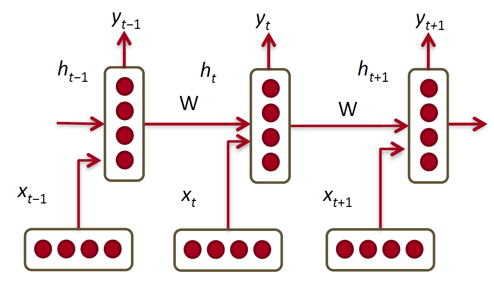
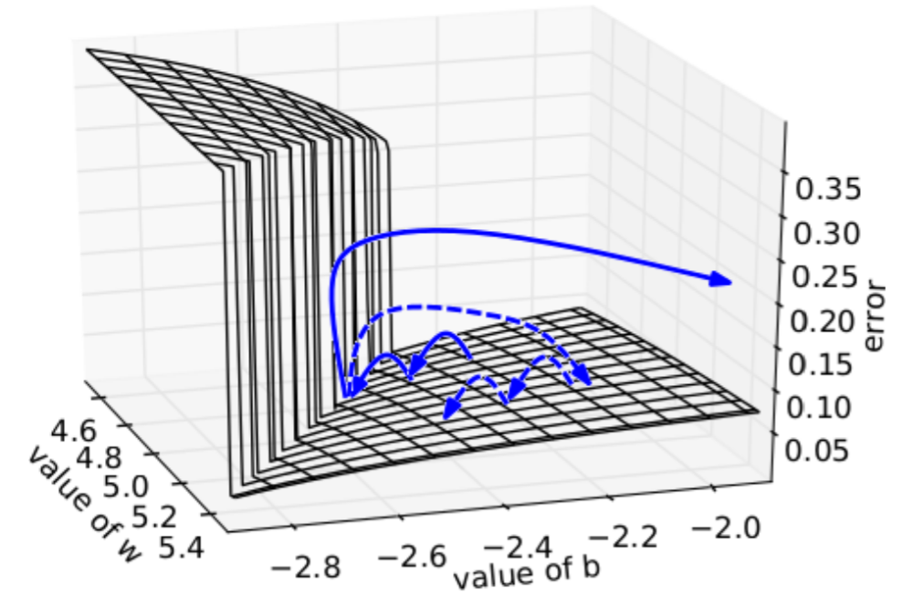
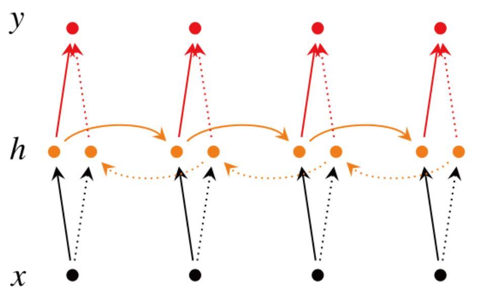
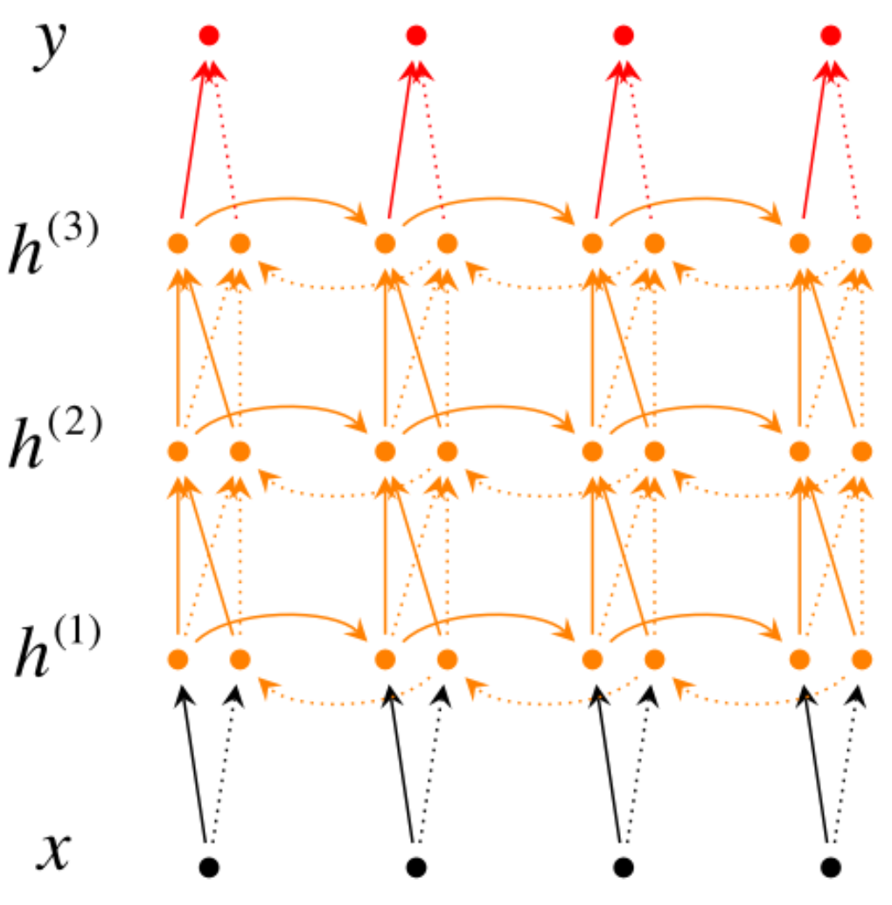
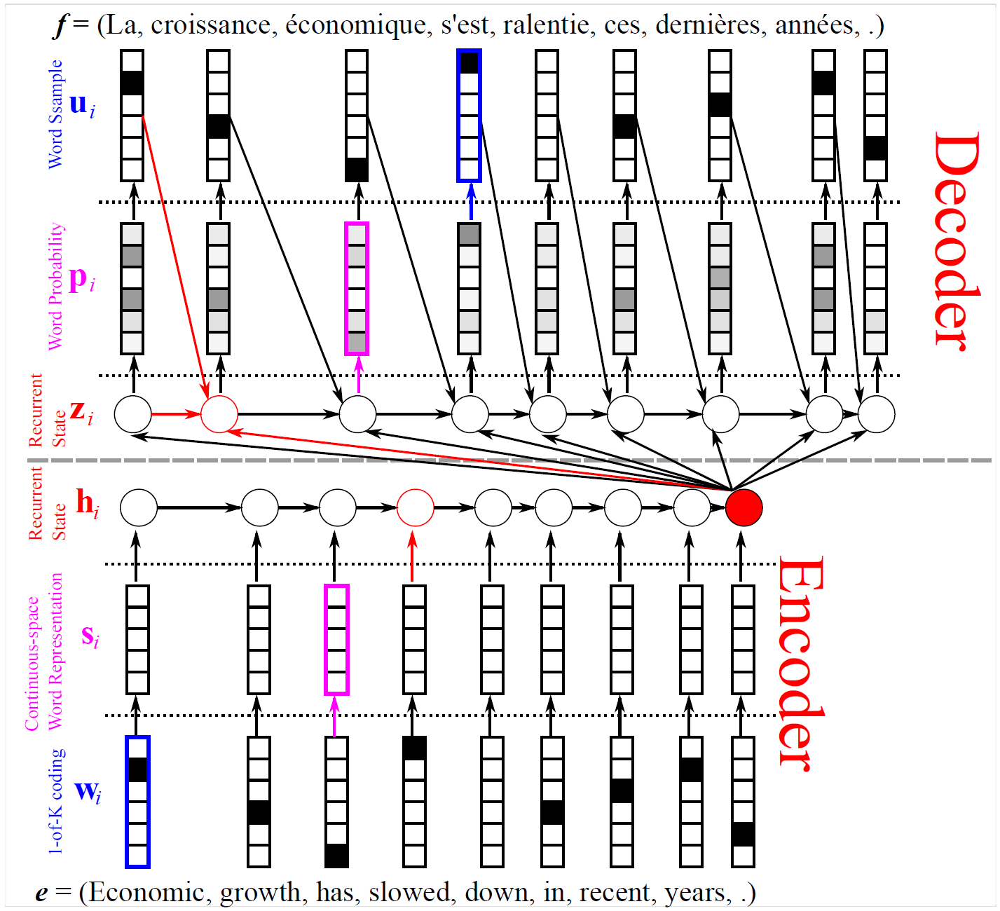
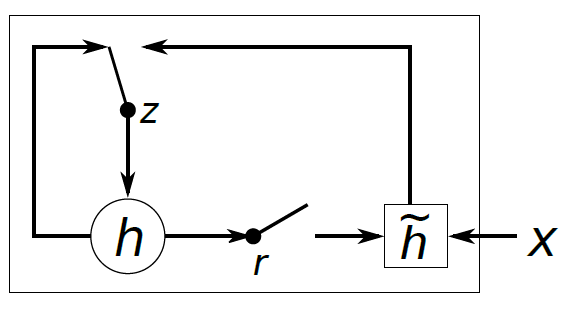
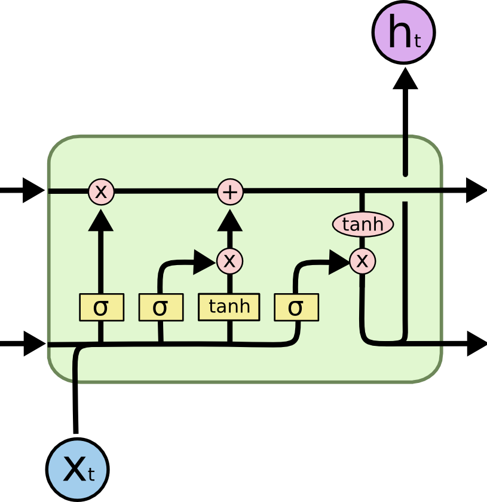

# Natural Language Processing with Deep Learning
> [YouTube Video List](https://www.youtube.com/playlist?list=PL3FW7Lu3i5Jsnh1rnUwq_TcylNr7EkRe6)
>
> [Syllabus](http://web.stanford.edu/class/cs224n/syllabus.html)

 

---

# Differential, Gradient, Jacobian, Chain Rule

[Review of differential calculus theory](../../source/doc/ReviewDifferentialCalculus.pdf)

 

---

# word2vec

## Some word representations:
- Taxonomy:
    > adept, expert, good, practices

    But it's impossible to keep up to date

- One-hot representation :
    > word :  [0, 0, ..., 0, 1, 0, ..., 0]
    >
    > The size of vector is the size of vocabulary

    But, for example, "motel" and "hotel" have no similarity between their vectors, they are orthogonal and the product is zero.

- Window based cooccurence matrix
    
    Count how many times two words appear together in a window.

    For example, there are three pharses :
    - I like deep learning
    - I like NLP
    - I enjoy flying

    If window length is 1 and the window is symmetric (irrelevant whether leX or right context), "I" has a vector as :
    
    | counts | I | like | enjoy | deep | learning | NLP | flying |
    | --- | --- | --- | --- | --- | --- | --- | --- |
    | I | 0 | 2 | 1 | 0 | 0 | 0 | 0 |

    Problems:
    - The size of matrix will increase with vocabulary.
    - Some words are too frequent.    

    Solutions:
    - Use SVD (Singular Value Decomposition) to reduce the matrix but the computational cost is  $O(mn^2)$ for a $(n,m)$ matrix.

    But it's hard to incorporate new words or documents.
    - Limit the number of occurrences or count closer words more.

> Idea is to predict surrounding words in a window of length m of every word.
>
> Bag of words, Hierarchical softmax
>
> Counte-based distributional models vs Neural network-based models

The objective funcion is to maximize the log probability of any context word given the current center word:

$$J(\theta)=\frac{1}{T}\sum\limits_{t=1}^T\sum\limits_{-m\leq j\leq m, j\neq 0} \log p(w_{t+j}|w_t)$$

where $\theta$ represents all variables and $T$ is the total number of words (not vocabulary).

The simplest formulation for $p(w_{t+j}\|w_t)$ is (o for outside, c for center):

$$p(o|c)=\frac{\exp(u_o^Tv_c)}{\sum\limits_{w=1}^V\exp(u_w^Tv_c)}$$

Here, every word has two vectors $p(w\|\cdot), p(\cdot\|w)$

To maximize $J(\theta)$, we calculate the gradient:

$$\frac{\partial}{\partial v_c} J(\theta) = \frac{1}{T}\sum\limits_{t=1}^T\sum\limits_{-m\leq j\leq m, j\neq 0} \frac{\partial}{\partial v_c}\log p(w_{t+j}|w_t)$$

$$\begin{align*}
\frac{\partial}{\partial v_c}\log p(w_o|w_c) &= \frac{\partial}{\partial v_c}\log \frac{\exp(u_o^Tv_c)}{\sum\limits_{w=1}^V\exp(u_w^Tv_c)}\\
&= \frac{\partial}{\partial v_c}u_o^Tv_c - \frac{\partial}{\partial v_c}\log\sum\limits_{w=1}^V\exp(u_w^Tv_c)\\
&= u_o - \frac{\sum\limits_{x=1}^V\exp(u_x^Tv_c)u_x}{\sum\limits_{w=1}^V\exp(u_w^Tv_c)}\\
&= u_o - \sum\limits_{x=1}^V\frac{\exp(u_x^Tv_c)}{\sum\limits_{w=1}^V\exp(u_w^Tv_c)}u_x\\
&= u_o - \sum\limits_{x=1}^Vp(x|c)u_x
\end{align*}$$

We can use Stochastic Gradient Descent to accelerate the optimization : update parameters after each window t.

## Skip-gram model
> [Word2Vec Tutorial - The Skip-Gram Model](http://mccormickml.com/2016/04/19/word2vec-tutorial-the-skip-gram-model/)
>
> Mikolov, Tomas, et al. "Distributed representations of words and phrases and their compositionality." Advances in neural information processing systems. 2013.

Since it's expensive to calculate the sum $\sum\limits_{w=1}^V\exp(u_w^Tv_c)$, we change the objective function as follows:

$$J(\theta) = \frac{1}{T}\sum\limits_{t=1}^T J_t(\theta)$$

$$J_t(\theta)=\log \sigma(u_o^Tv_c) + \sum\limits_{j\sim P(w)}\log \sigma(-u_j^Tv_c )$$

where $\sigma(x)=\frac{1}{1+e^{-x}}$, $P(w)=\frac{U(w)^{3/4}}{Z}$, $U(w)$ is [unigram distribution](https://en.wikipedia.org/wiki/N-gram), the frequency of the word $w$ and the 3/4 power make less frequent words be sampled more often.

### Negative sampling

We choose k negative samples (instead of choosing all words) and the objectif is to
- maximize probability that the real outside word appears (first term)
- minimize probability that random words appear around center word (second term)

Here k is 5-20 for small training sets and 2-5 for large datasets.

### Subsampling of frequent words

Some words occur frequently, like "the", "in", "a", etc. So we can apply a subsampling system:

Each word $w_i$ in the training set is discarded with probability $P(w_i)$:

$$P(w_i) = 1-\sqrt{\frac{t}{f(w_i)}}$$

where
- $f(w_i)$ is the fraction of the total words in the corpus that $w_i$ appears. For example, if the word "peanut" occurs 1000 times in a 1 illion word corpus, then $f(\text{"peanut"}) = 10^{-6}$.
- $t$ is a chosen threshold, typically around $10^{-5}$.
- $P(w_i)$ may be also $1-\sqrt{\frac{t}{f(w_i)}}-\frac{t}{f(w_i)}$

### Word pairs

Since "New York" has a much different meaning than the individual words "New" and "York", it makes sense to treat "New York", wherever it occurs in the text, as a single word with its own word vector representation.

## Continuous bag of words model (CBOW)

Predict center word from sum of surrounding word vectos instead of predicting surrounding single words from center word as in skip-gram model.

## Glove
> Pennington, Jeffrey, Richard Socher, and Christopher Manning. "Glove: Global vectors for word representation." Proceedings of the 2014 conference on empirical methods in natural language processing (EMNLP). 2014.

$$J(\theta) = \frac{1}{2}\sum\limits_{i,j=1}^W f(P_{ij}) (u_i^Tv_j-\log P_{ij})^2$$

where
- $f(x)=\min((\frac{x}{x_{\max}})^{\alpha},1)$, $\alpha$ is typically 3/4
- $P_{ij}=P(j\|i)=\frac{X_{ij}}{\sum\limits_k X_{ik}}$
- $X_{ij}$ represents the number of times word j occurs in the context of word i

## Evaluation

- Asymmetric context (only words to the lel) are not as good
- More training time helps
- More data helps, Wikipedia is better than news text

### Intrinsic Evaluation : Word Vector Analogies

a:b :: c:?

i.e. man:women :: king: ?, the relation between "man" and "women" is like the relation between "king" and which word ?

This can acutally be calculated by:

$$d=\arg\max\limits_i \frac{(x_b-x_a+x_c)^Tx_i}{\|x_b-x_a+x_c\|}$$

Some analogies:
- sister-brother, woman-man
- slow-slower-slowest, strong-stronger-strongest
- Paris-France, Rome-Italy

What about ambiguity ?
> Improving Word Representaions Via Global Context And Multiple Word Prototypes (Huang et al. 2012)

Cluster word windows around words, retrain with each word assigned to multiple different clusters bank1, bank2, etc.

### Extrinsic Evaluation

Find a person, organization or location

 

---

# Word Window Classification

## Cross entropy
> Cross-entropy can be re-written in terms of the entropy and Kullback-Leibler divergence between the two distributions

Assuming a ground truth (or gold or target) probability distribution that is 1 at the right class and 0 everywhere else, $p = [0,\cdots,0,1,0,\cdots,0]$ and our computed probability is q, then the cross entropy is:

$$H(p,q)=-\sum\limits_c p(c)\log q(c)$$

Since p is one-hot, the only term left is the negative log probability of the true class y:

$$H(p,q)=-\log q(y)$$

## Logistic regression

For a word vector $x$, the probability can be like

$$p(y|x) = \frac{\exp(f_y)}{\sum\limits_{c=1}^C\exp(f_c)}$$

where 
- $W$ is parameters, a matrix of size $(C,d)$ and $d$ is the size of word vector
- $f=Wx$ and $f_c$ is the c-th element of $f$
- $C$ is the number of class

We want to maximize the probability of the correct class y, so we minimize $J=-\log p(y\|x)$.

### Gradients

The corresponding gradients are:

- $\frac{\partial}{\partial x}$

    $$\frac{\partial J}{\partial x}=-W_{y\cdot}^T+\sum\limits_{c=1}^Cp(c|x)W_{c\cdot}$$

    where $W_{c\cdot}$ represents the c-th row of $W$.

    If we note $\hat{y}\in\mathbb{R}^{C}$ the softmax probability output vector, $\hat{y}_c=p(c\|x)$ and $t\in\mathbb{R}^{C}$ the target probability distribution (all 0's except at ground truth index of class y, where it's 1), then by noting

    $$\delta = \hat{y}-t$$

    we have

    $$\nabla_x J=W^T\delta$$

- $\frac{\partial}{\partial W}$

    $$\frac{\partial J}{\partial W_{c\cdot}}=-1_{c=y}x^T+p(c|x)x^T$$

    So, with the same notation, we have:

    $$\nabla_W J=\delta x^T$$

For the full dataset $(x_i,y_i)$, the cross entropy loss function (with regularization) is:

$$J(\theta)=\frac{1}{N}\sum\limits_{i=1}^N-\log(y_i|x_i)+\lambda\sum\limits_k\theta_k^2$$

where $f_{y_i}$ is the $y_i$-th element of $Wx_i$.

In the classification with word vectors, the parameters are not only $W$ but also the word vectors $x$. So the size of parameters are $Cd+Vd$ ($V$ is the size of vocabulary) and if there isn't enough data we may have overfitting problems.

## Window classification

The context is very important for classifying words. For example, "To sanction" can mean "to permit" or "to punish" and all depends on the context.

So we can classify a word in its context window of neighboring words. For example with window length 2, $x_{\text{window}}=x\in\mathbb{R}^{5d}$. We can use the same way as before to calculate the gradient. Just now we have $\nabla_x J\in\mathbb{R}^{5d}$ and we need to update the word vectors seperately.

## Neural networks

Now we use a single layer and an unnormalized score:

$$
\begin{align*}
z &= Wx+b\\
a &= f(z)\\
s &= U^Ta
\end{align*}
$$

### Max-margin loss

Idea is to make score of true window larger and corrupt window's score lower (until they are good enough):

$$\text{minimize}\quad J=\max(0,1-s+s_c)$$

where, for example, if we'd like to build a location classifier
- $s$ = score(museums in Paris are amazing) ("Paris" is a location)
- $s_c$ = score(Not all museums in Paris) ("museums" isn't a location)

Now the parameters are $U,W,b,x$. By noting ($\circ$ means element-wise multiplication)

$$\delta = U \circ f'(z)$$

The gradients are
- $\frac{\partial s}{\partial U} = a$
- $\frac{\partial s}{\partial W} = \delta x^T$ since $\frac{\partial s}{\partial W_{i\cdot}}=U_if'(z_i)\frac{\partial z_i}{\partial W_{i\cdot}}=U_if'(z_i)x^T$
- $\frac{\partial s}{\partial b} = \delta$
- $\frac{\partial s}{\partial x} = W^T \delta$ since $\frac{\partial s}{\partial x} = \sum\limits_i U_i f'(z_i) \frac{\partial z_i}{\partial x}= \sum\limits_i U_i f'(z_i) W_{i\cdot}^T$
- $\nabla J = 1_{1-s+s_c > 0}(-\nabla s + \nabla s_c)$

 

---

# Recurrent Neural Networks

Given list of word vectors $x_1,\cdots,x_{t-1},x_t,x_{t+1},\cdots,x_T$.

At a single time step,

$$
\begin{align*}
h_t &= f(W^{(hh)}h_{t-1}+W^{(hx)}x_{[t]})\\
\hat{y}_t &= \text{softmax}(W^{(S)}h_t)
\end{align*}
$$

where
- $W^{(hh)}\in\mathbb{R}^{D_h\times D_h}, W^{(hx)}\in\mathbb{R}^{D_h\times d}, W^{(S)}\in\mathbb{R}^{\|V\|\times D_h}$
- $x_{[t]}$ is word vector for the word appears at t-th time step. In other words, $x_{[t]}$ is the column vector of $L$ (embedding matrix) at index $[t]$ at time step $t$
- $\hat{P}( x_{t+1} = v_j \| x_t,\cdots,x_1)=\hat{y}_{t,j}$
- $h_0\in\mathbb{R}^{D_h}$ is some initialization vector for the hidden layer at time step 0

The corresponding loss function is

$$J^{(t)}(\theta)=-\sum\limits_{j=1}^{|V|}y_{t,j}\log \hat{y}_{t,j}$$

The total evaluation is (to minimize)

$$J=2^{\frac{1}{T}\sum\limits_{t=1}^T J^{(t)}}$$

## Simpler RNN

We now consider a simpler RNN:

$$
\begin{align*}
h_t &= Wf(h_{t-1})+W^{(hx)}x_{[t]}\\
\hat{y}_t &= W^{(S)}f(h_t)
\end{align*}
$$

The total error is the sum of each error at time steps $t$,

$$\frac{\partial E}{\partial W} = \sum\limits_{t=1}^T\frac{\partial E_t}{\partial W}$$

and we have the chain rule application:

$$\frac{\partial E_t}{\partial W}=\sum\limits_{k=1}^t \frac{\partial E_t}{\partial y_t}\frac{\partial y_t}{\partial h_t}\frac{\partial h_t}{\partial h_k}\frac{\partial h_k}{\partial W}$$

as well as

$$\frac{\partial h_t}{\partial h_k}=\prod\limits_{j=t}^{k+1}\frac{\partial h_j}{\partial h_{j-1}}$$

where

$$\frac{\partial h_j}{\partial h_{j-1}}=W\text{diag}(f'(h_{j-1}))$$

## The vanishing/exploding gradient problem

We can analyze the norms of the Jacobians

$$\|\frac{\partial h_j}{\partial h_{j-1}}\|\leq \|W\| \|\text{diag}(f'(h_{j-1}))\|\leq \beta_W \beta_h$$

where $\beta_W,\beta_h$ are upper bounds of the norms.

Then

$$\|\frac{\partial h_t}{\partial h_k}\|\leq\prod\limits_{j=t}^{k+1}\|\frac{\partial h_j}{\partial h_{j-1}}\|\leq (\beta_W \beta_h)^{t-k}$$

where the right side can vanish or explode quickly.

- The vanishing gradients can be fixed by initializing $W$ to identity matrix.
    > Parsing with Compositional Vector Grammars, Socher et al. 2013
    > 
    > A Simple Way to Initialize Recurrent Networks of Rectified Linear Units, Le et al. 2015

- The exploding gradients may be caused by high curvature walls and one solution is to limit the norm below a certain value.
    > On the difficulty of training Recurrent Neural Networks, Pascanu et al. 2013

    

## Bidirectional RNN

$$
\begin{align*}
\overrightarrow{h}_t &= \sigma(\overrightarrow{W}x_t+\overrightarrow{V}\overrightarrow{h}_{t-1}+\overrightarrow{b})\\
\overleftarrow{h}_t &= \sigma(\overleftarrow{W}x_t+\overleftarrow{V}\overleftarrow{h}_{t-1}+\overleftarrow{b})\\
\hat{y}_t &= g(U[\overrightarrow{h}_t;\overleftarrow{h}_t] + c)
\end{align*}
$$

## Deep Bidirectional RNN

$$
\begin{align*}
\overrightarrow{h}_t^{(i)} &= f(\overrightarrow{W}^{(i)}h_t^{(i-1)}+\overrightarrow{V}\overrightarrow{h}_{t-1}^{(i)}+\overrightarrow{b}^{(i)})\\
\overleftarrow{h}_t^{(i)} &= f(\overleftarrow{W}^{(i)}h_t^{(i-1)}+\overleftarrow{V}\overleftarrow{h}_{t-1}^{(i)}+\overleftarrow{b}^{(i)})\\
\hat{y}_t &= g(U[\overrightarrow{h}_t^{(L)};\overleftarrow{h}_t^{(L)}] + c)
\end{align*}
$$

 

---

# Machine Translation

## RNN Translation Model Extensions

- Train different RNN weights for encoding and decoding
- Compute every hidden state in decoder from
    - Previous hidden state (standard)
    - Last hidden vector of encoder $c=h_T$
    - Previous predicted output word $y_{t-1}$

    $$h_{D,t}=\phi_D(h_{t-1},c,y_{t-1})$$

    > Each input of $\phi$ has its own linear transformation matrix.
    >
    > i.e. $\phi(x,y,z) = f(Wx+Uy+Vz)$
- Train stacked/deep RNNs with multiple layers
    > Stacked RNN ?
- Potentially train bidirectional encoder
- Train input sequence in reverse order for simple optimization problem: Instead of A B C -> X Y, train with C B A -> X Y
    > The intuitive idea is: if A is translated to X, then by reversing the order, we decode X right after encoding A, they are closer.

## Gated Recurrent Units

$$
\begin{align*}
z_t &= \sigma(W^{(z)}x_t+U^{(z)}h_{t-1}) \\
r_t &= \sigma(W^{(r)}x_t+U^{(r)}h_{t-1}) \\
\tilde{h}_t &= \tanh(Wx_t+U(r_t\circ h_{t-1})) \\
h_t &= z_t\circ h_{t-1}+(1-z_t)\circ \tilde{h}_t
\end{align*}
$$

where $\circ$ means element-wise multiplication.

- $\tilde{h}_t$ is a new memory content
- $z_t$ is update gate

    Units with long-term dependencies ofen have update gates very active

    - if it close to 0, then $\tilde{h}_t$ ignores previous memory and the new word information dominate.
    - if it close to 1, then we can copy information in that unit through many time steps. Less vanishing gradient!

- $r_t$ is reset gate

    Units with short-term dependencies ofen have reset gates very active
    
    - if it close to 0, then the final memory ignore previous hidden state and it allows model to drop information that is irrelevant in the future
    - if it close to 1, then the final memory $h_t$ ignores current state

## Long-short-term-memories (LSTMs)
> [Understanding LSTM Networks](http://colah.github.io/posts/2015-08-Understanding-LSTMs/)

$$
\begin{align*}
i_t &= \sigma(W^{(i)}x_t+U^{(i)}h_{t-1}) \\
f_t &= \sigma(W^{(f)}x_t+U^{(f)}h_{t-1}) \\
o_t &= \sigma(W^{(o)}x_t+U^{(o)}h_{t-1}) \\
\tilde{c}_t &= \tanh(W^{(c)}x_t+U^{(c)}h_{t-1}) \\
c_t &= f_t\circ c_{t-1}+i_t\circ \tilde{c}_t \\
h_t &= o_t \circ \tanh(c_t)
\end{align*}
$$

where
- $i_t$ is input gate
- $f_t$ is forget gate
- $o_t$ is output gate
- $\tilde{c}_t$ is new memory cell
- $c_t$ is final memory cell
- $h_t$ is final hidden state

## Pointer Sentinel Mixture Models

 

 

---

# Not finished
> Notes until lecture 8