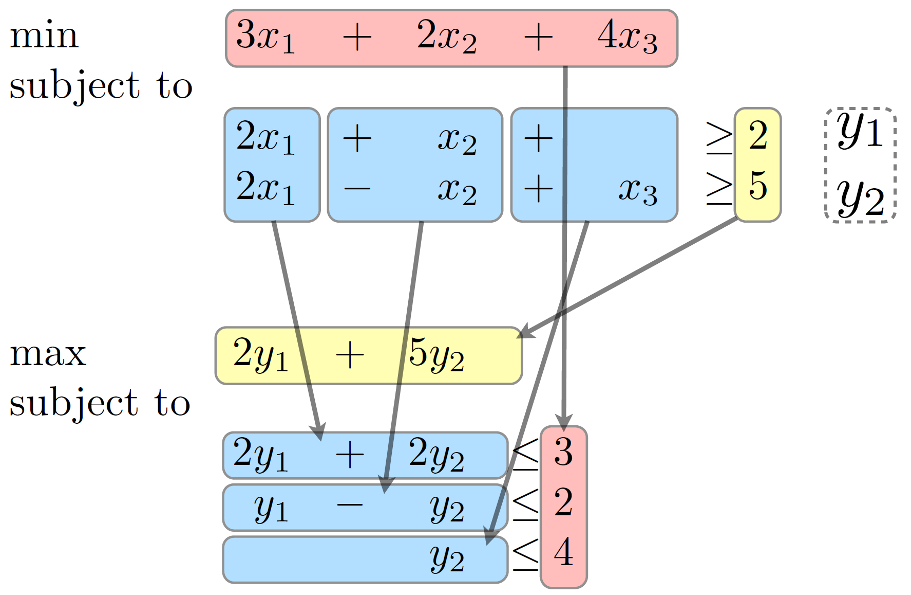

# Coursera Discrete Optimization

 

---

## Knapsack

-   Relaxed problem
-   Branch and bound
-   Depth/Breast/Best First Search
-   Limited Discrepancy Search
    >   following the heuristic means branching left
    >
    >   explore the search space in increasing order of mistakes

-   Algorithm
    -   Discard items that don't fit
    -   Multiply each value by something so that values are small. Max scaled value = N = 100 * n (n is number of items)
        >   The value is at least 1-1/c OPT for N = c*n

    -   Round values down to integers (floor)
    -   Dynamic program for the scaled and rounded problem

 

---

## Constraint Programming

-   Global Constraint
    -   alldifferent(x1,...,xn)
    -   table constraint
        >   only several combination of values are admissibles

-   Break variable symmetries
    >   Impose an ordering on the variables

-   Redundant constraints
    >   Do not exclude any solution by reduce the search space and boost the propagation of other constraints

-   Other ideas
    -   Choose value then choose variable
    -   Domain splitting
    -   Randomization and restarts

 

---

## Local Search

Strategies
-   Minimize violations
    >   choose a decision variable that appear in the most violations and assign it to a value that minimizes its violations

- SWAP
    >   Instead of reassigning values, swap the values of variables
    >
    >   The traveling tournament problem (TTP) / Warehouse location / Car Sequencing

The traveling tournament problem (TTP)
- swap homes
- swap rounds
- swap teams
- partial swap rounds
- partial swap teams

-   K-OPT
    >   The traveling salesman problem (TSP)

-   Escape local minima
    -   Different start point
    -   Metropolis algorithm
        >   accept a move if it improves the objective value or, in case it does not, with some probability which depends on how “bad” the move is
        >
        >   exp(-delta/t) where t is the temperature

    -   Simulated Annealing
        >   Use Metropolis algorithm but adjust the temperature dynamically
        >   
        >   start with a high temperature and decrease the temperature progressively
        >
        >   t *= alpha

        - Generate initial solution
        - Initialize t
        - loop
            - Local Search
            - Update(Maybe reheat)

    -   Tabu
        >   maintain the sequence of nodes already visited
        >
        >   select the best configurations that is not tabu

        -   Short-term memory
            >   only keep a small suffix of visited nodes
            
            may increase or decrease the size of the list dynamically
            -   decrease when the selected node degrades the objective
            -   increase when the selected node improves the objective

        -   swap
            >   when tabu[i,j] > iteration, it's a tabu
            >
            >   when apply a move tabu[i,j] += L

            we can use (i, j, f1, f2) to denote that i and j have been swapped from an objective value f1 to f2
        -   if the solution is good enough, it's not a tabu
    -   Restart
    -   Reheat
    -   Others
        -   Intensification
            >   store high-quality solutions and return to them periodically

        -   Diversification
            >   when the search is not producing improvement, diversify the current state, e.g., randomly change the values of some variables

        -   Strategic oscillation
            >   change the percentage of time spent in the feasible and infeasible regions

        - Variable neighborhood search
        - Guided local search
        - Ant-colony optimization
        - Hybrid evolutionary algorithms
        - Scatter search
    
-   Select neighbor
    -   Select the first/best neighbor/improvement
    -   Select the first legal
    -   Multi-stage selection
        - select the variable with the most violations and select the value with the fewest violation
        - select the variable with some violations and select the value with the fewest violation

    -   Select at random

 

---

## Linear Programming

$$\begin{align*}
\min~c_1x_1+\cdots&+c_nx_n\\
a_{11}x_1+\cdots&+a_{1n}x_n= b_1\\
\cdots&\\
a_{m1}x_1+\cdots&+a_{mn}x_n= b_m\\
x_i\geq& 0
\end{align*}$$

where $b_m\geq 0$

The solution space is convex set and the optimal solution is at a vertex.

### Simplex Algorithm

1. A basic feasible solution (BFS) is like:

    $$\begin{align*}
    x_1 &= b_1 + \sum\limits_{i=m_1}^na_{1i}x_i\\
    &\cdots\\
    x_m &= b_m + \sum\limits_{i=m_1}^na_{mi}x_i
    \end{align*}$$

    If we take $x_i=0$ for $i=m+1,\cdots,n$, then $x_i=b_i$ for $i=1,\cdots,m$

1. To move from a BFS to another, we choose

    - An entering variable $x_e$ at right-hand side with $c_e<0$
    - A leaving variable $x_l$ at left-hand side:

        $$l=\arg\min\limits_{i:a_{ie}<0}\frac{b_i}{-a_{ie}}$$

    If $c_e<0$ and all $a_{ie}\geq 0$, then we can increase $x_e$ arbitrarily to decrease the objective arbitrarily.

    If $b_i=0$, make $x_i$ leave do not change the objective.

    To assure the termination, we can select always the first possible entering variable.

1. To find the first BFS, we can introduce artificial variables:

    $$\begin{align*}
    \min~c_1x_1+\cdots&+c_nx_n\\
    a_{11}x_1+\cdots&+a_{1n}x_n+y_1 b_1\\
    \cdots&\\
    a_{m1}x_1+\cdots&+a_{mn}x_n+y_m b_m\\
    x_i\geq& 0\\
    y_j\geq& 0\\
    \end{align*}$$

    It's a BFS with $y_j$ at left-hand side.

    In order to remove $y_j$, we consider the following problem

    $$\begin{align*}
    \min~y_1+\cdots&+y_m\\
    a_{11}x_1+\cdots&+a_{1n}x_n+y_1 b_1\\
    \cdots&\\
    a_{m1}x_1+\cdots&+a_{mn}x_n+y_m b_m\\
    x_i\geq& 0
    \end{align*}$$

#### Matrix Representation

| $c_1$ | ... | $c_n$ | $-z$ |
| $a_{11}$ | ... | $a_{1n}$ | $b_1$ |
| ... | ... | ... | ... |
| $a_{i1}$ | ... | $a_{in}$ | $b_i$ |
| ... | ... | ... | ... |
| $a_{m1}$ | ... | $a_{mn}$ | $b_m$ |

#### Duality

- Primal

    $$\begin{align*}
    \min~c^Tx\\
    Ax\geq b\\
    x\geq 0
    \end{align*}$$

- Dual

    $$\begin{align*}
    \max~y^Tb\\
    y^TA\geq c^T\\
    y\geq 0
    \end{align*}$$

If the primal has an optimal solution, the dual has an optimal solution with the same cost:

$$c^Tx \geq y^TAx \geq y^Tb$$

# Notes until LP5