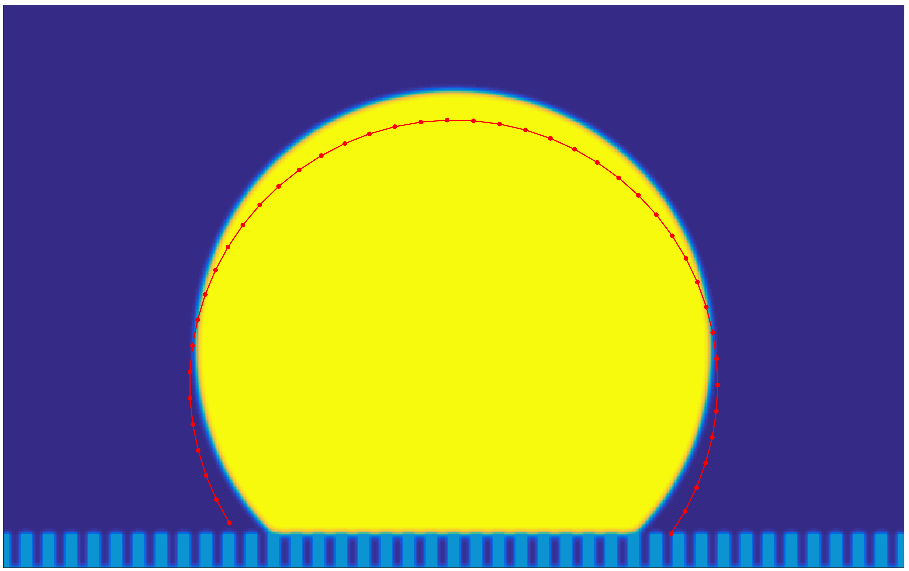
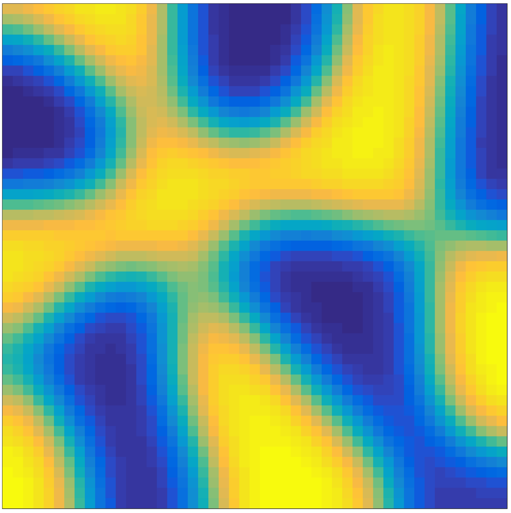
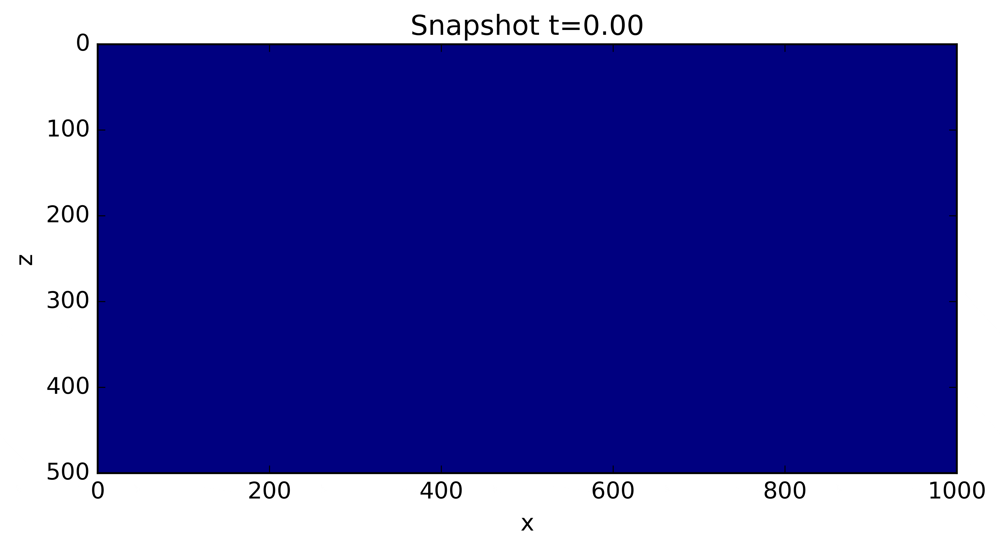

## Improving Question Answering with Knowledge Graphs

> NLP Course Project at UCL, Feb 2019 - Mar. 2019.

Inspired by [(Zhong et al., 2018)](https://arxiv.org/abs/1809.03568), we propose to extract concept graphs from sentences and use the graph structures to answer [commonsense-based questions](https://www.tau-nlp.org/commonsenseqa). Our method obtained an accuracy of 62.56% (an absolute improvement of 1.05% over the vanilla BERT-based model). We also introduce some handcrafted rules to reformulate questions, which results in a higher accuracy of 63.93%.

[Report](project/CommonsenseQA.pdf)

---

## Human Activity Recognition with SVM

> Numerical Optimization Course Project at UCL, May 2019 - May 2019.

In this project, sequential minimal optimization and augmented Lagrangian method are implemented to solve the dual problem of SVM. [Human Activity Recognition Dataset](https://www.kaggle.com/uciml/human-activity-recognition-with-smartphones) is used to test multi-class kernel SVM performance and different kernels, optimization methods, multi-class methods, and regularization are studied.

[Report](project/SVM.pdf)

---

## Playing Atari with Deep Reinforcement Learning

> Research Project at Ecole Polytechnique, Oct. 2017 - Mar. 2018.

This project is mainly based on [(Oh et al., 2015)](https://arxiv.org/abs/1507.08750). I reimplemented the algorithm using Keras and Tensorflow and tested multiple different research ideas on auto-encoder. Some studies are also carried out on VAE and A3C.

[Report](project/Atari.pdf)

---

## Link Prediction in Citation Networks

> NLP Course Project at Ecole Polytechnique, Feb. 2018 - Mar. 2018.

In this project, we extract both structure-based (neighbourhood, node2vec) and node-based (word2vec, doc2vec) features to perform link prediction in citation networks. Different neural network as well as tree-based algorithms (Xgboost, LightGBM) are compared.

[Report](project/LinkPred.pdf)

---

## Hacking the Paris metro
> Big Data Course Project at Ecole Polytechnique, May 2017 - Jun. 2017.

Basic machine learning algorithms (SVM, Decision Tree, etc.) are applied to predict the train delay using real data acquired from RATP.

[Report](project/RATP.pdf)

[GitHub](https://github.com/mathpluscode/2A-INF442-Project#hacking-the-paris-metro)

---

## Lotus Effect and Spinodal Decomposition Phenomenon
> Numerical Simulation of PDE Course Project at Ecole Polytechnique, Apr. 2017 - Jun. 2017.

This project studies lotus effect and spinodal decomposition phenomenon using finite difference method (FDM).

[Report](project/lotus/report.pdf)

---

## Underground Explosion

> Concurrency Course Project at Ecole Polytechnique, Apr. 2017 - Mar. 2017.

The propagation of the acoustic waves engendered by an explosion of a bomb is simulated using finite difference method. JAVA Threads are used to perform parallel computing.

Report ([EN](project/seism/report) / [FR](project/seism/report.pdf))

[GitHub](https://github.com/mathpluscode/2A-INF431-Project)